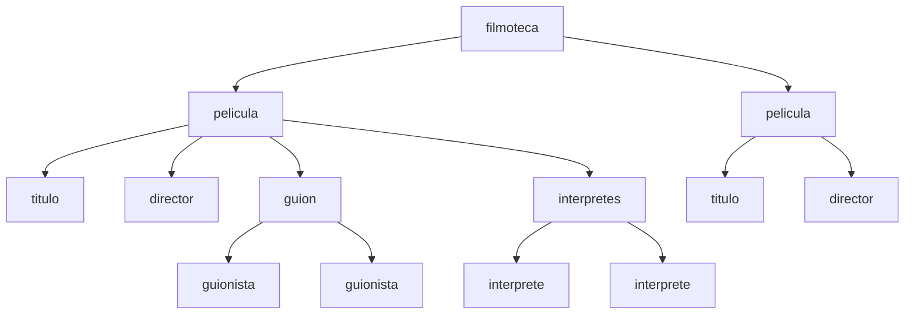

# Árbol XML y rutas XPath

## La estructura en árbol de un documento XML

Cuando un procesador analiza un documento XML no lo interpreta como un simple texto, sino como una estructura jerárquica formada por nodos relacionados entre sí.

Cada elemento XML ocupa una posición dentro de esa jerarquía:

- Existe un único nodo raíz.
- Los elementos contenidos dentro de otro elemento son sus hijos.
- El elemento que contiene a otros es su padre.
- Los elementos con el mismo padre son hermanos.
- Todos los nodos situados por debajo forman sus descendientes.

XPath utiliza esta estructura en árbol para localizar información dentro del documento.

## Documento XML de ejemplo

A lo largo de esta unidad utilizaremos la siguiente filmoteca:

```xml
<filmoteca>

    <pelicula estreno="1942" minutos="102">
        <titulo>Casablanca</titulo>
        <director>Michael Curtiz</director>

        <guion>
            <guionista>Howard Koch</guionista>
            <guionista>Julius J. Epstein</guionista>
        </guion>

        <interpretes>
            <interprete papel="Rick Blaine">
                Humphrey Bogart
            </interprete>

            <interprete papel="Ilsa Lund">
                Ingrid Bergman
            </interprete>
        </interpretes>

    </pelicula>

    <pelicula estreno="1960" minutos="125">
        <titulo>The Apartment</titulo>
        <director>Billy Wilder</director>
    </pelicula>

</filmoteca>
```

## Representación del árbol XML

La estructura anterior puede representarse gráficamente de la siguiente manera:



Observa que:

- `filmoteca` es el nodo raíz.
- Existen dos elementos `pelicula`.
- Cada película contiene varios elementos hijos.
- Los elementos `guionista` dependen de `guion`.
- Los elementos `interprete` dependen de `interpretes`.

!!! info "Idea importante"
    XPath siempre navega por este árbol de nodos. Comprender la estructura jerárquica del documento es imprescindible para construir consultas correctamente.

---

## Relaciones entre nodos

A partir del árbol anterior podemos identificar distintas relaciones.

### Nodo raíz

Es el elemento principal del documento.

```xml
<filmoteca>
```

Todo el resto de elementos dependen de él.

### Nodo padre

Es cualquier elemento que contiene otros elementos.

Por ejemplo:

```xml
<guion>
    <guionista>Howard Koch</guionista>
</guion>
```

`guion` es el padre de `guionista`.

### Nodo hijo

Es cualquier elemento contenido dentro de otro.

```xml
<titulo>Casablanca</titulo>
```

`titulo` es hijo de `pelicula`.

### Nodos hermanos

Son los elementos que comparten el mismo padre.

```xml
<titulo>Casablanca</titulo>
<director>Michael Curtiz</director>
```

`titulo` y `director` son hermanos porque ambos pertenecen a la misma película.

### Nodo descendiente

Es cualquier nodo que se encuentra por debajo de otro en el árbol.

Los nodos:

```xml
<guionista>
<interprete>
```

son descendientes de `pelicula`.

---

## Tipos de nodos en XPath

XPath trabaja sobre diferentes tipos de nodos.

### Nodo elemento

Representa una etiqueta XML.

```xml
<titulo>Casablanca</titulo>
```

`titulo` es un nodo elemento.

### Nodo texto

Representa el contenido almacenado dentro de un elemento.

```xml
<titulo>Casablanca</titulo>
```

El texto:

```text
Casablanca
```

es un nodo de texto.

### Nodo atributo

Representa información adicional asociada a un elemento.

```xml
<pelicula estreno="1942">
```

El atributo es:

```xml
estreno="1942"
```

### Nodo comentario

Permite incluir anotaciones.

```xml
<!-- Película clásica -->
```

---

## ¿Qué es una ruta XPath?

XPath localiza información utilizando expresiones de ruta.

Estas rutas funcionan de manera parecida a los caminos utilizados para acceder a carpetas en un sistema operativo.

Por ejemplo:

```text
Documentos/LM/Tema5
```

En XML podríamos navegar mediante:

```xpath
/filmoteca/pelicula/titulo
```

---

## Rutas absolutas

Una ruta absoluta comienza desde la raíz del documento.

Siempre empieza con una barra:

```xpath
/
```

Ejemplo:

```xpath
/filmoteca/pelicula/titulo
```

Interpretación:

1. Comienza en `filmoteca`.
2. Accede a `pelicula`.
3. Localiza los elementos `titulo`.

Resultado:

```xml
<titulo>Casablanca</titulo>

<titulo>The Apartment</titulo>
```

---

## Rutas relativas

Las rutas relativas se evalúan desde el nodo actual.

Por ejemplo:

```xpath
titulo
```

buscará el elemento `titulo` hijo del nodo donde se está ejecutando la consulta.

!!! tip "Nodo de contexto"
    El nodo desde el que se realiza una búsqueda recibe el nombre de nodo de contexto.

---

## La búsqueda con //

La doble barra es una de las expresiones más utilizadas en XPath.

```xpath
//
```

Permite localizar elementos sin necesidad de indicar toda la ruta.

### Ejemplo

```xpath
//guionista
```

Resultado:

```xml
<guionista>Howard Koch</guionista>

<guionista>Julius J. Epstein</guionista>
```

XPath recorre todos los niveles del documento hasta encontrar los elementos indicados.

---

## Comparación de rutas

| Expresión XPath | Resultado |
|-----------------|------------|
| `/filmoteca/pelicula/titulo` | Todos los títulos mediante ruta completa |
| `//titulo` | Todos los títulos del documento |
| `//director` | Todos los directores |
| `/filmoteca/pelicula` | Todas las películas |
| `//guionista` | Todos los guionistas |
| `//interprete` | Todos los intérpretes |

---

## Ejemplos prácticos

### Obtener todos los títulos

```xpath
//titulo
```

Resultado:

```text
Casablanca
The Apartment
```

---

### Obtener todos los directores

```xpath
//director
```

Resultado:

```text
Michael Curtiz
Billy Wilder
```

---

### Obtener todos los guionistas

```xpath
//guionista
```

Resultado:

```text
Howard Koch
Julius J. Epstein
```

---

### Obtener todas las películas

```xpath
//pelicula
```

---

### Obtener todos los intérpretes

```xpath
//interprete
```

Resultado:

```text
Humphrey Bogart
Ingrid Bergman
```

---

## Errores frecuentes

!!! danger "Confundir / con //"

    La expresión:

    ```xpath
    /titulo
    ```

    no encontrará resultados porque `titulo` no cuelga directamente de la raíz.

    Debe utilizarse:

    ```xpath
    //titulo
    ```

---

!!! danger "Olvidar el nodo raíz"

    La expresión:

    ```xpath
    /pelicula/titulo
    ```

    es incorrecta porque la raíz del documento es `filmoteca`.

    La ruta correcta es:

    ```xpath
    /filmoteca/pelicula/titulo
    ```

---

!!! danger "Pensar que XPath busca textos"

    XPath selecciona nodos, no palabras.

    La expresión:

    ```xpath
    //Casablanca
    ```

    es incorrecta porque `Casablanca` no es un elemento XML.

---

## Resumen

!!! success "Ideas clave"

    - XML se organiza como una estructura jerárquica en forma de árbol.
    - Los nodos pueden ser elementos, atributos, textos o comentarios.
    - XPath navega utilizando rutas.
    - Las rutas absolutas comienzan por `/`.
    - Las rutas relativas parten del nodo de contexto.
    - La expresión `//` permite buscar en cualquier nivel del documento.
    - Comprender la estructura del árbol es fundamental para construir consultas XPath correctamente.