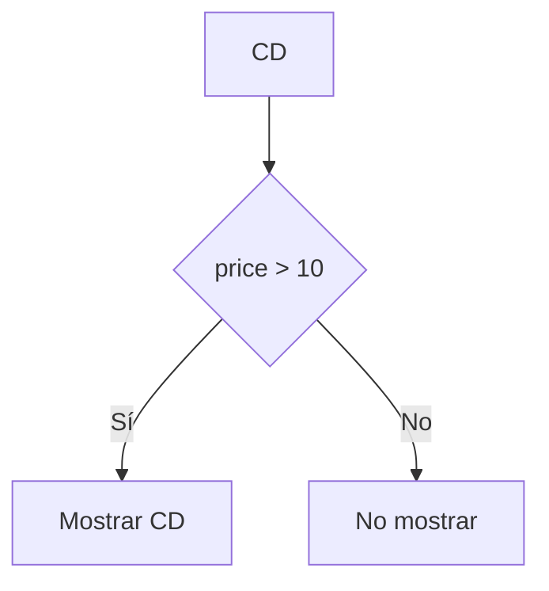
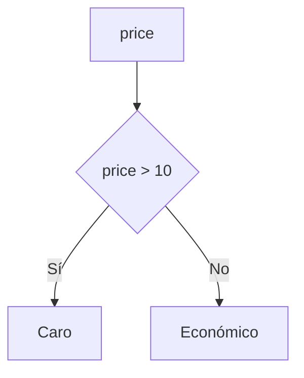
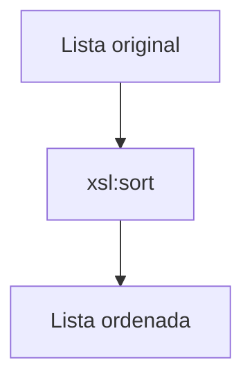

# Condicionales y ordenación en XSLT

## Introducción

Hasta ahora hemos aprendido a:

- Definir plantillas mediante `xsl:template`.
- Extraer información con `xsl:value-of`.
- Recorrer colecciones utilizando `xsl:for-each`.
- Aplicar plantillas mediante `xsl:apply-templates`.

Sin embargo, las transformaciones reales suelen necesitar algo más:

- Mostrar información solo cuando se cumple una condición.
- Mostrar resultados diferentes según determinadas circunstancias.
- Ordenar los datos antes de generar la salida.

Para ello XSLT incorpora las instrucciones:

- `xsl:if`
- `xsl:choose`
- `xsl:when`
- `xsl:otherwise`
- `xsl:sort`

!!! info "Idea clave"
    Estas instrucciones permiten controlar qué información aparece en el documento generado y en qué orden se muestra.

---

## Documento XML de ejemplo

Utilizaremos el mismo catálogo de CDs empleado en el tema:

```xml
<catalog>

    <cd>
        <title>Empire Burlesque</title>
        <artist>Bob Dylan</artist>
        <company>Columbia</company>
        <price>10.90</price>
        <year>1985</year>
    </cd>

    <cd>
        <title>Hide your heart</title>
        <artist>Bonnie Tyler</artist>
        <company>CBS Records</company>
        <price>9.90</price>
        <year>1988</year>
    </cd>

    <cd>
        <title>Greatest Hits</title>
        <artist>Dolly Parton</artist>
        <company>RCA</company>
        <price>9.90</price>
        <year>1982</year>
    </cd>

</catalog>
```

---

# xsl:if

## ¿Para qué sirve?

La instrucción `xsl:if` permite ejecutar un bloque de código únicamente cuando se cumple una condición.

Su comportamiento es similar al de una sentencia `if` en un lenguaje de programación.

---

## Sintaxis

```xml
<xsl:if test="condicion">

    ...

</xsl:if>
```

La condición se expresa mediante XPath.

---

## Ejemplo básico

Mostrar únicamente los CDs cuyo precio sea superior a 10 euros.

```xml
<xsl:for-each select="catalog/cd">

    <xsl:if test="price > 10">

        <p>

            <xsl:value-of select="title"/>

        </p>

    </xsl:if>

</xsl:for-each>
```

---

## Resultado generado

```html
<p>Empire Burlesque</p>
```

Solo aparece ese CD porque es el único cuyo precio supera 10 €.

---

## Funcionamiento visual



---

## Otro ejemplo

Mostrar el precio solamente si supera los 10 euros.

```xml
<xsl:if test="price > 10">

    Precio destacado:

    <xsl:value-of select="price"/>

</xsl:if>
```

---

# xsl:choose

## ¿Para qué sirve?

`xsl:choose` permite evaluar varias condiciones diferentes.

Es equivalente a una estructura:

```text
if
else if
else
```

de un lenguaje de programación.

---

## Elementos utilizados

| Elemento | Función |
|-----------|----------|
| `xsl:choose` | Bloque principal |
| `xsl:when` | Condición |
| `xsl:otherwise` | Alternativa |

---

## Sintaxis

```xml
<xsl:choose>

    <xsl:when test="condicion">

        ...

    </xsl:when>

    <xsl:otherwise>

        ...

    </xsl:otherwise>

</xsl:choose>
```

---

## Ejemplo

```xml
<xsl:choose>

    <xsl:when test="price > 10">

        Caro

    </xsl:when>

    <xsl:otherwise>

        Económico

    </xsl:otherwise>

</xsl:choose>
```

---

## Resultado

Para un CD con:

```xml
<price>10.90</price>
```

obtendremos:

```text
Caro
```

Para uno con:

```xml
<price>9.90</price>
```

obtendremos:

```text
Económico
```

---

## Ejemplo completo del catálogo

```xml
<xsl:for-each select="catalog/cd">

<p>

<xsl:value-of select="title"/>

-

<xsl:choose>

    <xsl:when test="price > 10">

        Caro

    </xsl:when>

    <xsl:otherwise>

        Económico

    </xsl:otherwise>

</xsl:choose>

</p>

</xsl:for-each>
```

Resultado:

```text
Empire Burlesque - Caro

Hide your heart - Económico

Greatest Hits - Económico
```

---

## Funcionamiento visual



---

## Diferencias entre xsl:if y xsl:choose

| xsl:if | xsl:choose |
|----------|-----------|
| Una única condición | Varias condiciones |
| Puede no generar salida | Siempre puede existir alternativa |
| Más simple | Más flexible |

---

### Ejemplo con xsl:if

```xml
<xsl:if test="price > 10">

    Caro

</xsl:if>
```

Si no se cumple la condición no aparece nada.

---

### Ejemplo con xsl:choose

```xml
<xsl:choose>

    <xsl:when test="price > 10">

        Caro

    </xsl:when>

    <xsl:otherwise>

        Económico

    </xsl:otherwise>

</xsl:choose>
```

Siempre genera una respuesta.

---

# xsl:sort

## ¿Para qué sirve?

Permite ordenar los datos antes de mostrarlos.

Normalmente se utiliza dentro de:

```xml
<xsl:for-each>
```

---

## Sintaxis

```xml
<xsl:sort select="campo"/>
```

---

## Ordenar por título

```xml
<xsl:for-each select="catalog/cd">

    <xsl:sort select="title"/>

    <p>

        <xsl:value-of select="title"/>

    </p>

</xsl:for-each>
```

---

## Resultado

```text
Empire Burlesque

Greatest Hits

Hide your heart
```

Los títulos aparecen ordenados alfabéticamente.

---

## Ordenar por año

```xml
<xsl:sort select="year"/>
```

Resultado:

```text
1982
1985
1988
```

---

## Orden descendente

Podemos indicar explícitamente el orden.

```xml
<xsl:sort
    select="price"
    order="descending"/>
```

---

## Ejemplo

```xml
<xsl:for-each select="catalog/cd">

    <xsl:sort
        select="price"
        order="descending"/>

    <p>

        <xsl:value-of select="title"/>

        -

        <xsl:value-of select="price"/>

    </p>

</xsl:for-each>
```

Resultado:

```text
Empire Burlesque - 10.90

Hide your heart - 9.90

Greatest Hits - 9.90
```

---

## Funcionamiento visual



---

# Combinando condiciones y ordenación

Las instrucciones pueden utilizarse conjuntamente.

Ejemplo:

```xml
<xsl:for-each select="catalog/cd">

    <xsl:sort select="title"/>

    <xsl:if test="price > 10">

        <p>

            <xsl:value-of select="title"/>

        </p>

    </xsl:if>

</xsl:for-each>
```

Proceso:

1. Se ordenan los CDs por título.
2. Se evalúa la condición.
3. Solo se muestran los CDs con precio superior a 10 €.

---

# Resumen de instrucciones

| Elemento | Función |
|-----------|----------|
| `xsl:if` | Ejecuta código si se cumple una condición |
| `xsl:choose` | Evalúa varias condiciones |
| `xsl:when` | Define una condición dentro de choose |
| `xsl:otherwise` | Alternativa cuando no se cumple ninguna condición |
| `xsl:sort` | Ordena datos antes de procesarlos |

---

# Actividades prácticas

??? question "Actividad 1. Utilizando xsl:if"

    Escribe una instrucción XSLT que muestre únicamente los CDs cuyo precio sea superior a 10 €.

    ??? success "Ver solución"

        ```xml
        <xsl:if test="price > 10">

            <xsl:value-of select="title"/>

        </xsl:if>
        ```

---

??? question "Actividad 2. Utilizando xsl:choose"

    Escribe una estructura que muestre:

    - "Caro" si el precio es superior a 10.
    - "Económico" en cualquier otro caso.

    ??? success "Ver solución"

        ```xml
        <xsl:choose>

            <xsl:when test="price > 10">

                Caro

            </xsl:when>

            <xsl:otherwise>

                Económico

            </xsl:otherwise>

        </xsl:choose>
        ```

---

??? question "Actividad 3. Ordenando información"

    Escribe la instrucción necesaria para ordenar los CDs por:

    1. Título.
    2. Año.
    3. Precio descendente.

    ??? success "Ver solución"

        **Por título**

        ```xml
        <xsl:sort select="title"/>
        ```

        **Por año**

        ```xml
        <xsl:sort select="year"/>
        ```

        **Por precio descendente**

        ```xml
        <xsl:sort
            select="price"
            order="descending"/>
        ```

---

??? question "Actividad 4. Interpretando código"

    ¿Qué mostrará la siguiente transformación?

    ```xml
    <xsl:if test="price > 10">

        Premium

    </xsl:if>
    ```

    si el precio es:

    ```xml
    <price>9.90</price>
    ```

    ??? success "Ver solución"

        No mostrará nada.

        La condición:

        ```xml
        price > 10
        ```

        no se cumple.

---

??? question "Reto final"

    Diseña una transformación que:

    - Recorra todos los CDs.
    - Los ordene por título.
    - Muestre el título.
    - Indique si son "Caros" o "Económicos".

    ??? success "Ver solución"

        ```xml
        <xsl:for-each select="catalog/cd">

            <xsl:sort select="title"/>

            <p>

                <xsl:value-of select="title"/>

                -

                <xsl:choose>

                    <xsl:when test="price > 10">

                        Caro

                    </xsl:when>

                    <xsl:otherwise>

                        Económico

                    </xsl:otherwise>

                </xsl:choose>

            </p>

        </xsl:for-each>
        ```

        Resultado aproximado:

        ```text
        Empire Burlesque - Caro

        Greatest Hits - Económico

        Hide your heart - Económico
        ```

---
# Práctica guiada XML → XSLT → HTML

??? question "Práctica integrada: Catálogo de CDs"

    A partir del siguiente documento XML:

    ```xml
    <?xml version="1.0" encoding="UTF-8"?>

    <catalog>

        <cd>

            <title>Empire Burlesque</title>

            <artist>Bob Dylan</artist>

            <price>10.90</price>

            <year>1985</year>

        </cd>

        <cd>

            <title>Hide your heart</title>

            <artist>Bonnie Tyler</artist>

            <price>9.90</price>

            <year>1988</year>

        </cd>

        <cd>

            <title>Greatest Hits</title>

            <artist>Dolly Parton</artist>

            <price>9.90</price>

            <year>1982</year>

        </cd>

    </catalog>
    ```

    Diseña una hoja XSLT que:

    1. Genere una página HTML.
    2. Muestre un título principal.
    3. Construya una tabla con:
       - Título
       - Artista
       - Precio
       - Categoría
    4. Ordene los CDs por título.
    5. Clasifique cada CD como:
       - Caro (precio > 10)
       - Económico (precio ≤ 10)
    6. Muestre el número total de CDs.

    ---

    ??? tip "Pista 1"

        Todo documento XSLT comienza con:

        ```xml
        <xsl:stylesheet
            version="1.0"
            xmlns:xsl="http://www.w3.org/1999/XSL/Transform">
        ```

        y una plantilla principal:

        ```xml
        <xsl:template match="/">
        ```

    ---

    ??? tip "Pista 2"

        Primero crea la estructura HTML:

        ```html
        <html>
        <head>
        <body>
        ```

        y añade un encabezado:

        ```html
        <h1>Catálogo de CDs</h1>
        ```

    ---

    ??? tip "Pista 3"

        Para recorrer todos los CDs necesitas:

        ```xml
        <xsl:for-each select="catalog/cd">
        ```

    ---

    ??? tip "Pista 4"

        La ordenación debe realizarse dentro del `for-each`.

        Investiga dónde colocar:

        ```xml
        <xsl:sort select="title"/>
        ```

    ---

    ??? tip "Pista 5"

        Para mostrar datos:

        ```xml
        <xsl:value-of select="title"/>
        ```

        ```xml
        <xsl:value-of select="artist"/>
        ```

        ```xml
        <xsl:value-of select="price"/>
        ```

    ---

    ??? tip "Pista 6"

        Para obtener las categorías "Caro" o "Económico" necesitas una estructura:

        ```xml
        <xsl:choose>
        ```

        junto con:

        ```xml
        <xsl:when>
        ```

        y

        ```xml
        <xsl:otherwise>
        ```

    ---

    ??? tip "Pista 7"

        Para contar CDs utiliza la función XPath:

        ```xpath
        count(catalog/cd)
        ```

        que puede mostrarse mediante:

        ```xml
        <xsl:value-of select="count(catalog/cd)"/>
        ```

    ---

    ??? success "Solución completa"

        ```xml
        <?xml version="1.0" encoding="UTF-8"?>

        <xsl:stylesheet
            version="1.0"
            xmlns:xsl="http://www.w3.org/1999/XSL/Transform">

            <xsl:template match="/">

                <html>

                <head>

                    <title>Catálogo de CDs</title>

                </head>

                <body>

                    <h1>Catálogo de CDs</h1>

                    <table border="1">

                        <tr>

                            <th>Título</th>
                            <th>Artista</th>
                            <th>Precio</th>
                            <th>Categoría</th>

                        </tr>

                        <xsl:for-each select="catalog/cd">

                            <xsl:sort select="title"/>

                            <tr>

                                <td>
                                    <xsl:value-of select="title"/>
                                </td>

                                <td>
                                    <xsl:value-of select="artist"/>
                                </td>

                                <td>
                                    <xsl:value-of select="price"/>
                                </td>

                                <td>

                                    <xsl:choose>

                                        <xsl:when test="price > 10">

                                            Caro

                                        </xsl:when>

                                        <xsl:otherwise>

                                            Económico

                                        </xsl:otherwise>

                                    </xsl:choose>

                                </td>

                            </tr>

                        </xsl:for-each>

                    </table>

                    <p>

                        Número total de CDs:

                        <xsl:value-of select="count(catalog/cd)"/>

                    </p>

                </body>

                </html>

            </xsl:template>

        </xsl:stylesheet>
        ```

        ### Resultado esperado

        | Título | Artista | Precio | Categoría |
        |----------|----------|----------|------------|
        | Empire Burlesque | Bob Dylan | 10.90 | Caro |
        | Greatest Hits | Dolly Parton | 9.90 | Económico |
        | Hide your heart | Bonnie Tyler | 9.90 | Económico |

        Número total de CDs:

        ```text
        3
        ```

        ### Conceptos utilizados

        ✅ `xsl:template`

        ✅ `xsl:for-each`

        ✅ `xsl:sort`

        ✅ `xsl:value-of`

        ✅ `xsl:choose`

        ✅ `xsl:when`

        ✅ `xsl:otherwise`

        ✅ `count()`

        ✅ Generación de HTML

        ✅ Generación de tablas
---

# Resumen

!!! success "Ideas clave"

    - `xsl:if` permite ejecutar código condicionalmente.
    - `xsl:choose` permite evaluar varias condiciones.
    - `xsl:when` y `xsl:otherwise` funcionan de forma similar a un if-else.
    - `xsl:sort` permite ordenar datos antes de mostrarlos.
    - Las condiciones utilizan expresiones XPath.
    - Es habitual combinar `for-each`, `sort` y estructuras condicionales en una misma transformación.
    - Estos elementos permiten generar documentos HTML dinámicos y adaptados al contenido del XML.