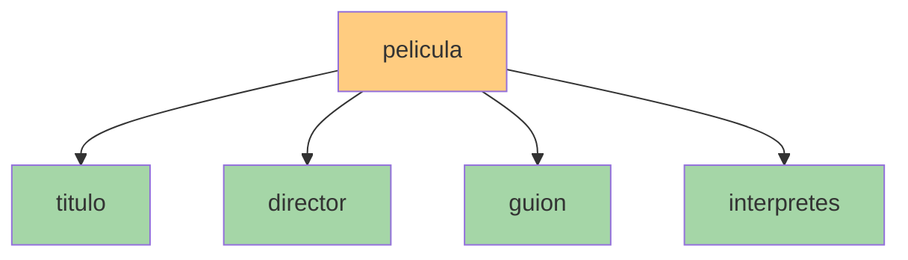
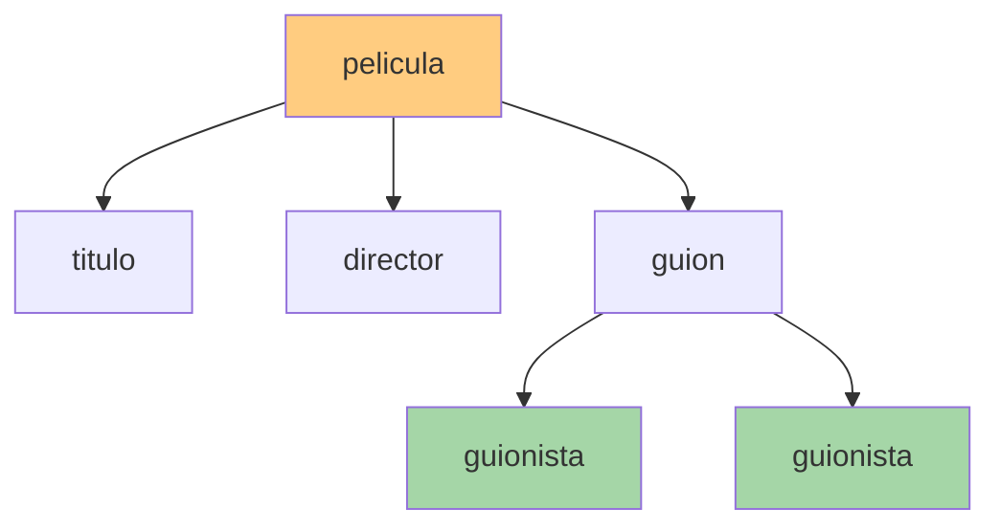
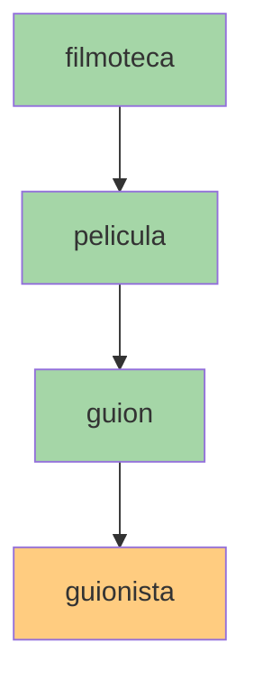

# Ejes y selección de nodos

## Navegando por el árbol XML

Una vez comprendida la estructura en árbol de un documento XML, el siguiente paso consiste en aprender a desplazarse por ella.

Para ello XPath utiliza los **ejes** (*axes*), que permiten indicar la relación existente entre el nodo actual y los nodos que queremos localizar.

Los ejes pueden entenderse como las distintas direcciones por las que podemos movernos dentro del árbol XML:

- Hacia abajo (hijos y descendientes).
- Hacia arriba (padres y ancestros).
- Sobre el propio nodo actual.
- Hacia los atributos.

!!! info "Idea clave"
    Los ejes indican **dónde buscar**, mientras que los nodos de comprobación indican **qué buscar**.

---

## Documento de ejemplo

Utilizaremos el siguiente fragmento XML durante toda la unidad:

```xml
<filmoteca>

    <pelicula estreno="1942" minutos="102">

        <titulo>Casablanca</titulo>

        <director>Michael Curtiz</director>

        <guion>
            <guionista>Howard Koch</guionista>
            <guionista>Julius J. Epstein</guionista>
        </guion>

        <interpretes>
            <interprete papel="Rick Blaine">
                Humphrey Bogart
            </interprete>

            <interprete papel="Ilsa Lund">
                Ingrid Bergman
            </interprete>
        </interpretes>

    </pelicula>

</filmoteca>
```

---

## ¿Qué es el nodo de contexto?

Toda expresión XPath se evalúa desde una posición concreta dentro del árbol XML denominada **nodo de contexto**.

Por ejemplo, si nos encontramos sobre el elemento:

```xml
<pelicula>
```

podemos acceder directamente a sus hijos:

```xml
<titulo>
<director>
<guion>
<interpretes>
```

!!! tip "Nodo de contexto"
    Puede entenderse como nuestra posición actual dentro del árbol XML. Todas las búsquedas parten de dicho nodo.

---

## Ejes XPath

### El eje child::

El eje `child::` selecciona los hijos directos del nodo actual.

Es el eje utilizado por defecto en XPath.

### Sintaxis completa

```xpath
child::titulo
```

### Forma abreviada

```xpath
titulo
```

Ambas expresiones son equivalentes.

### Ejemplo

```xpath
child::director
```

Resultado:

```xml
<director>Michael Curtiz</director>
```

### Representación gráfica



Los elementos verdes representan los hijos directos de `pelicula`.

---

## El eje descendant::

Permite seleccionar todos los descendientes del nodo actual.

Incluye:

- Hijos.
- Nietos.
- Bisnietos.
- Cualquier nivel inferior.

### Sintaxis completa

```xpath
descendant::guionista
```

### Forma abreviada

```xpath
//guionista
```

### Ejemplo

```xpath
descendant::guionista
```

Resultado:

```xml
<guionista>Howard Koch</guionista>
<guionista>Julius J. Epstein</guionista>
```

### Representación gráfica



---

## El eje attribute::

Permite acceder a los atributos del nodo actual.

### Sintaxis completa

```xpath
attribute::estreno
```

### Forma abreviada

```xpath
@estreno
```

### Ejemplo

```xpath
//pelicula/@estreno
```

Resultado:

```text
1942
```

### Obtener todos los atributos

```xpath
@*
```

Resultado:

```text
estreno="1942"
minutos="102"
```

---

## El eje self::

Selecciona el propio nodo de contexto.

### Sintaxis completa

```xpath
self::
```

### Forma abreviada

```xpath
.
```

### Ejemplo

```xpath
.
```

Si el nodo actual es:

```xml
<titulo>Casablanca</titulo>
```

el resultado será el propio nodo `titulo`.

### Uso habitual

```xpath
//titulo[.='Casablanca']
```

Selecciona el título cuyo contenido es exactamente:

```text
Casablanca
```

---

## El eje parent::

Permite subir al nodo padre.

### Sintaxis completa

```xpath
parent::
```

### Forma abreviada

```xpath
..
```

### Ejemplo

Partiendo del elemento:

```xml
<titulo>Casablanca</titulo>
```

la expresión:

```xpath
..
```

devuelve:

```xml
<pelicula>
```

### Ejemplo práctico

```xpath
//titulo[.='Casablanca']/../director
```

Proceso:

1. Localiza el título "Casablanca".
2. Sube al nodo padre (`pelicula`).
3. Accede a su hijo `director`.

Resultado:

```xml
<director>Michael Curtiz</director>
```

---

## El eje ancestor::

Permite localizar todos los ancestros del nodo actual.

Incluye:

- Padre.
- Abuelo.
- Bisabuelo.
- Nodo raíz.

### Ejemplo

```xpath
//guionista[.='Howard Koch']/ancestor::*
```

Resultado:

```text
guion
pelicula
filmoteca
```

### Representación gráfica



---

## Nodos de comprobación

Una vez indicado el eje de búsqueda, XPath necesita saber qué tipo de nodo debe localizar.

Los **nodos de comprobación** especifican exactamente qué queremos encontrar.

---

## Selección por nombre

Permite localizar elementos concretos indicando su nombre.

### Ejemplo

```xpath
//director
```

Resultado:

```xml
<director>Michael Curtiz</director>
```

---

## El comodín *

El carácter `*` selecciona cualquier eleme*to.

### Ejemplo

```xpath
/filmot*ca/pelicula/*
```

Resultado:

```xml
<titulo>
<director>
<guion>
<interpretes>
```

Todos los hijos directos de `pelicula` son seleccionados.

---

## text()

Permite acceder únicamente al contenido textual de un nodo.

### Ejemplo

```xpath
//titulo/text()
```

Resultado:

```text
Casablanca
```

---

### Diferencia entre nodo y texto

```xpath
//titulo
```

Devuelve:

```xml
<titulo>Casablanca</titulo>
```

Mientras que:

```xpath
//titulo/text()
```

Devuelve:

```text
Casablanca
```

---

## node()

Selecciona cualquier tipo de nodo.

### Ejemplo

```xpath
//pelicula/node()
```

Resultado:

```xml
<titulo>Casablanca</titulo>

<director>Michael Curtiz</director>

<guion>
    ...
</guion>

<interpretes>
    ...
</interpretes>
```

---

## Resumen de ejes y nodos de comprobación

| Elemento XPath | Abreviatura | Descripción | Ejemplo de uso |
|---------------|-------------|-------------|----------------|
| child:: | (ninguna) | Hijos directos | `pelicula/titulo` |
| descendant:: | // | Descendientes en cualquier nivel | `//guionista` |
| attribute:: | @ | Atributos | `//pelicula/@estreno` |
| self:: | . | Nodo actual | `//titulo[.='Casablanca']` |
| parent:: | .. | Nodo padre | `//titulo/..` |
| ancestor:: | (ninguna) | Ancestros o antecesores | `//guionista/ancestor::*` |
| * | * | Cualquier elemento | `/filmoteca/pelicula/*` |
| text() | text() | Texto del nodo | `//titulo/text()` |
| node() | node() | Cualquier tipo de nodo | `//pelicula/node()` |

---

## Actividades prácticas

??? question "Actividad 1. Identificando relaciones"

    Observa el XML:

    ```xml
    <empresa>

        <departamento>

            <empleado>
                <nombre>Ana</nombre>
            </empleado>

            <empleado>
                <nombre>Carlos</nombre>
            </empleado>

        </departamento>

    </empresa>
    ```

    Indica:

    1. El nodo raíz.
    2. Los hijos de `empresa`.
    3. Los hijos de `departamento`.
    4. Los nodos hermanos.
    5. Los descendientes de `empresa`.

    ??? success "Ver solución"

        **1. El nodo raíz**

        El nodo raíz es:

        ```xml
        <empresa>
        ```

        ya que es el elemento principal que contiene al resto de elementos del documento.

        **2. Los hijos de `empresa`**

        El elemento hijo directo de `empresa` es:

        ```xml
        <departamento>
        ```

        **3. Los hijos de `departamento`**

        Los hijos directos de `departamento` son:

        ```xml
        <empleado>
        <empleado>
        ```

        **4. Los nodos hermanos**

        Los dos elementos:

        ```xml
        <empleado>
        ```

        son nodos hermanos porque comparten el mismo padre (`departamento`).

        **5. Los descendientes de `empresa`**

        Todos los elementos situados por debajo de `empresa` en el árbol XML son:

        ```text
        departamento
        empleado
        nombre
        ```

        El árbol XML puede representarse de la siguiente forma:

        ```text
        empresa
        │
        └── departamento
            ├── empleado
            │   └── nombre
            └── empleado
                └── nombre
        ```
---
??? question "Actividad 2. Utilizando child::"

    Escribe expresiones XPath para obtener:

    1. El título de la película.
    2. El director.
    3. Los hijos directos de `pelicula`.

    ??? success "Ver solución"

        **1. Obtener el título de la película**

        Como `titulo` es un hijo directo de `pelicula`, podemos utilizar:

        ```xpath
        pelicula/titulo
        ```

        o de forma explícita:

        ```xpath
        pelicula/child::titulo
        ```

        ---

        **2. Obtener el director**

        Como `director` también es hijo directo de `pelicula`:

        ```xpath
        pelicula/director
        ```

        o bien:

        ```xpath
        pelicula/child::director
        ```

        ---

        **3. Obtener todos los hijos directos de `pelicula`**

        Utilizando el comodín `*`:

        ```xpath
        pelicula/*
        ```

        Esta expresión seleccionará todos los elementos hijos de `pelicula`, por ejemplo:

        ```xml
        <titulo>
        <director>
        <guion>
        <interpretes>
        ```

        !!! info "Recuerda"
            El eje `child::` es el eje utilizado por defecto en XPath, por lo que normalmente se omite.

            Estas dos expresiones son equivalentes:

            ```xpath
            pelicula/titulo
            ```

            ```xpath
            pelicula/child::titulo
            ```
---
??? question "Actividad 3. Utilizando descendant::"

    Escribe expresiones XPath que permitan obtener:

    1. Todos los guionistas.
    2. Todos los intérpretes.
    3. Todos los descendientes de `pelicula`.

    ??? success "Ver solución"

        **1. Obtener todos los guionistas**

        Los elementos `guionista` son descendientes del elemento `pelicula`, por lo que podemos localizarlos mediante:

        ```xpath
        //guionista
        ```

        o de forma explícita:

        ```xpath
        //pelicula/descendant::guionista
        ```

        Resultado esperado:

        ```xml
        <guionista>Howard Koch</guionista>
        <guionista>Julius J. Epstein</guionista>
        ```

        ---

        **2. Obtener todos los intérpretes**

        Podemos utilizar:

        ```xpath
        //interprete
        ```

        o bien:

        ```xpath
        //pelicula/descendant::interprete
        ```

        Resultado esperado:

        ```xml
        <interprete papel="Rick Blaine">
            Humphrey Bogart
        </interprete>

        <interprete papel="Ilsa Lund">
            Ingrid Bergman
        </interprete>
        ```

        ---

        **3. Obtener todos los descendientes de `pelicula`**

        Para seleccionar todos los nodos que cuelgan de `pelicula` utilizamos:

        ```xpath
        //pelicula/descendant::*
        ```

        Esta expresión devolverá elementos como:

        ```xml
        <titulo>
        <director>
        <guion>
        <guionista>
        <interpretes>
        <interprete>
        ```

        !!! info "Recuerda"
            El eje `descendant::` permite acceder a todos los niveles inferiores del árbol XML (hijos, nietos, bisnietos, etc.).

            Por este motivo:

            ```xpath
            descendant::guionista
            ```

            encuentra los elementos `guionista`, aunque no sean hijos directos de `pelicula`.           
---

??? question "Actividad 4. Accediendo a atributos"

    Obtén mediante XPath:

    1. El atributo `estreno`.
    2. El atributo `minutos`.
    3. Todos los atributos de la película.

    ??? success "Ver solución"

        **1. Obtener el atributo `estreno`**

        Como `estreno` es un atributo del elemento `pelicula`, debemos utilizar el eje de atributos (`@`):

        ```xpath
        //pelicula/@estreno
        ```

        Resultado esperado:

        ```text
        1942
        ```

        ---

        **2. Obtener el atributo `minutos`**

        De forma análoga:

        ```xpath
        //pelicula/@minutos
        ```

        Resultado esperado:

        ```text
        102
        ```

        ---

        **3. Obtener todos los atributos de la película**

        Podemos utilizar el comodín `*` sobre el eje de atributos:

        ```xpath
        //pelicula/@*
        ```

        Resultado esperado:

        ```text
        estreno="1942"
        minutos="102"
        ```

        !!! info "Recuerda"
            Los atributos no son elementos XML. Por ello no pueden seleccionarse mediante `child::`.

            Para acceder a un atributo debemos utilizar:

            ```xpath
            @nombreAtributo
            ```

            o de forma explícita:

            ```xpath
            attribute::nombreAtributo
            ```

            Ambas expresiones son equivalentes.

        !!! tip "Consejo"
            En XPath es muy frecuente utilizar la abreviatura `@` porque hace las consultas más cortas y fáciles de leer.

            Por ejemplo:

            ```xpath
            @estreno
            ```

            equivale a:

            ```xpath
            attribute::estreno
            ```
---
??? question "Actividad 5. Navegando hacia arriba"

    Suponiendo que el nodo actual es:

    ```xml
    <titulo>Casablanca</titulo>
    ```

    Responde:

    1. ¿Qué devuelve `.`?
    2. ¿Qué devuelve `..`?
    3. ¿Cuál es el padre de `titulo`?
    4. ¿Cuál es su ancestro raíz?

    ??? success "Ver solución"

        **1. ¿Qué devuelve `.`?**

        El símbolo `.` representa el **nodo actual** o nodo de contexto.

        En este caso devuelve:

        ```xml
        <titulo>Casablanca</titulo>
        ```

        ---

        **2. ¿Qué devuelve `..`?**

        El símbolo `..` representa el **nodo padre** del nodo actual.

        Si el nodo actual es:

        ```xml
        <titulo>Casablanca</titulo>
        ```

        entonces devuelve:

        ```xml
        <pelicula>
        ```

        ---

        **3. ¿Cuál es el padre de `titulo`?**

        El elemento padre es:

        ```xml
        <pelicula>
        ```

        porque contiene al elemento `titulo` dentro de su estructura.

        Representación simplificada:

        ```text
        pelicula
        └── titulo
        ```

        ---

        **4. ¿Cuál es su ancestro raíz?**

        Partiendo del nodo `titulo`, los ancestros son:

        ```text
        pelicula
        filmoteca
        ```

        Por tanto, el ancestro raíz es:

        ```xml
        <filmoteca>
        ```

        ---

        !!! info "Recuerda"

            Los selectores más utilizados para navegar por el árbol XML son:

            ```xpath
            .
            ```

            Nodo actual.

            ```xpath
            ..
            ```

            Nodo padre.

            ```xpath
            ancestor::*
            ```

            Todos los ancestros del nodo actual.

        Por ejemplo:

        ```xpath
        //titulo/..
        ```

        devuelve el elemento `pelicula`.

        Y:

        ```xpath
        //titulo/ancestor::*
        ```

        devuelve:

        ```text
        pelicula
        filmoteca
        ```
---
??? question "Actividad 6. Nodos de comprobación"

    Escribe consultas XPath para:

    1. Seleccionar todos los directores.
    2. Seleccionar cualquier hijo de `pelicula`.
    3. Obtener únicamente los textos de todos los títulos.
    4. Obtener todos los nodos contenidos dentro de `pelicula`.

    ??? success "Ver solución"

        **1. Seleccionar todos los directores**

        Para buscar todos los elementos `director` del documento:

        ```xpath
        //director
        ```

        Resultado esperado:

        ```xml
        <director>Michael Curtiz</director>
        ```

        ---

        **2. Seleccionar cualquier hijo de `pelicula`**

        Utilizamos el comodín `*`, que permite seleccionar cualquier elemento.

        ```xpath
        //pelicula/*
        ```

        Resultado esperado:

        ```xml
        <titulo>
        <director>
        <guion>
        <interpretes>
        ```

        ---

        **3. Obtener únicamente los textos de todos los títulos**

        Para recuperar solo el contenido textual de cada elemento `titulo`:

        ```xpath
        //titulo/text()
        ```

        Resultado esperado:

        ```text
        Casablanca
        The Apartment
        ```

        Observa que no se devuelven las etiquetas XML, únicamente el texto contenido en ellas.

        ---

        **4. Obtener todos los nodos contenidos dentro de `pelicula`**

        Utilizamos la función `node()`:

        ```xpath
        //pelicula/node()
        ```

        Resultado esperado:

        ```xml
        <titulo>Casablanca</titulo>

        <director>Michael Curtiz</director>

        <guion>
            ...
        </guion>

        <interpretes>
            ...
        </interpretes>
        ```

        ---

        !!! info "Recuerda"

            Los nodos de comprobación indican **qué queremos localizar** dentro del árbol XML.

            Los más utilizados son:

            | Expresión | Significado |
            |------------|-------------|
            | `director` | Elementos con ese nombre |
            | `*` | Cualquier elemento |
            | `text()` | Contenido textual |
            | `node()` | Cualquier tipo de nodo |

            Por ejemplo:

            ```xpath
            //titulo
            ```

            devuelve los elementos completos.

            Mientras que:

            ```xpath
            //titulo/text()
            ```

            devuelve únicamente su contenido textual.
---
??? question "Actividad 7. ¿Qué devuelve esta consulta?"

    Indica el resultado de las siguientes expresiones XPath:

    ```xpath
    //titulo
    ```

    ```xpath
    //guionista
    ```

    ```xpath
    //pelicula/@estreno
    ```

    ```xpath
    //titulo/text()
    ```

    ```xpath
    //guionista/ancestor::*
    ```

    ??? success "Ver solución"

        ### Consulta 1

        ```xpath
        //titulo
        ```

        Selecciona todos los elementos `titulo` del documento.

        Resultado:

        ```xml
        <titulo>Casablanca</titulo>

        <titulo>The Apartment</titulo>
        ```

        ---

        ### Consulta 2

        ```xpath
        //guionista
        ```

        Selecciona todos los elementos `guionista`.

        Resultado:

        ```xml
        <guionista>Howard Koch</guionista>

        <guionista>Julius J. Epstein</guionista>

        <guionista>Billy Wilder</guionista>
        ```

        ---

        ### Consulta 3

        ```xpath
        //pelicula/@estreno
        ```

        Selecciona el atributo `estreno` de todas las películas.

        Resultado:

        ```text
        1942
        1960
        ```

        ---

        ### Consulta 4

        ```xpath
        //titulo/text()
        ```

        Devuelve únicamente el contenido textual de cada elemento `titulo`.

        Resultado:

        ```text
        Casablanca
        The Apartment
        ```

        Observa que las etiquetas XML ya no aparecen porque `text()` selecciona únicamente los nodos de texto.

        ---

        ### Consulta 5

        ```xpath
        //guionista/ancestor::*
        ```

        Selecciona todos los ancestros de cada elemento `guionista`.

        Para el guionista:

        ```xml
        <guionista>Howard Koch</guionista>
        ```

        los ancestros son:

        ```text
        guion
        pelicula
        filmoteca
        ```

        ---

        !!! info "Cómo analizar este tipo de ejercicios"

            Cuando veas una consulta XPath, analiza siempre:

            1. **Desde dónde se busca** (ruta o eje XPath).
            2. **Qué nodo se selecciona**.
            3. **Si devuelve elementos, atributos o texto**.

            Por ejemplo:

            ```xpath
            //titulo
            ```

            devuelve elementos.

            Mientras que:

            ```xpath
            //titulo/text()
            ```

            devuelve únicamente el contenido textual de esos elementos.
---
??? question "Actividad 8. Corrigiendo errores"

    Corrige las siguientes expresiones XPath:

    ```xpath
    estreno
    ```

    ```xpath
    /guionista
    ```

    ```xpath
    child::@estreno
    ```

    Explica brevemente por qué son incorrectas.

    ??? success "Ver solución"

        ### Expresión 1

        Expresión incorrecta:

        ```xpath
        estreno
        ```

        Corrección:

        ```xpath
        @estreno
        ```

        o bien:

        ```xpath
        attribute::estreno
        ```

        **¿Por qué es incorrecta?**

        Porque `estreno` es un atributo y no un elemento XML. Si escribimos únicamente:

        ```xpath
        estreno
        ```

        XPath buscará un elemento llamado `estreno`, no un atributo.

        ---

        ### Expresión 2

        Expresión incorrecta:

        ```xpath
        /guionista
        ```

        Corrección:

        ```xpath
        //guionista
        ```

        o bien:

        ```xpath
        /filmoteca/pelicula/guion/guionista
        ```

        **¿Por qué es incorrecta?**

        La barra inicial (`/`) indica que la búsqueda comienza en la raíz del documento.

        XPath intentaría localizar:

        ```text
        raíz
        └── guionista
        ```

        pero en nuestro documento los elementos `guionista` están contenidos dentro de:

        ```text
        filmoteca
        └── pelicula
            └── guion
                └── guionista
        ```

        Por tanto, debemos indicar la ruta completa o utilizar una búsqueda con `//`.

        ---

        ### Expresión 3

        Expresión incorrecta:

        ```xpath
        child::@estreno
        ```

        Corrección:

        ```xpath
        @estreno
        ```

        o:

        ```xpath
        attribute::estreno
        ```

        **¿Por qué es incorrecta?**

        El eje `child::` solo puede utilizarse para buscar elementos hijos.

        Los atributos pertenecen al eje:

        ```xpath
        attribute::
        ```

        Por ese motivo no es válido combinar:

        ```xpath
        child::@estreno
        ```

        ---

        !!! warning "Error muy frecuente"

            Muchos principiantes confunden atributos y elementos.

            Por ejemplo:

            ```xml
            <pelicula estreno="1942">
            ```

            `estreno` es un atributo.

            Sin embargo:

            ```xml
            <estreno>1942</estreno>
            ```

            sería un elemento XML.

            Las consultas XPath para ambos casos son completamente diferentes.

        !!! tip "Consejo"

            Cuando una consulta XPath no devuelve resultados, comprueba siempre:

            1. Si estás buscando un elemento o un atributo.
            2. Si la ruta comienza desde la raíz correcta.
            3. Si el eje utilizado es el adecuado (`child`, `descendant`, `attribute`, etc.).
            4. Si el nodo realmente existe en el documento XML.
---
??? question "Reto final"

    Dado el siguiente XML:

    ```xml
    <biblioteca>

        <libro isbn="978123">

            <titulo>Introducción a XML</titulo>

            <autor>
                <nombre>Ana Pérez</nombre>
            </autor>

        </libro>

    </biblioteca>
    ```

    Construye expresiones XPath para obtener:

    1. El título del libro.
    2. El atributo ISBN.
    3. El nombre del autor.
    4. Todos los descendientes de `libro`.
    5. Todos los ancestros de `nombre`.
    6. Todos los hijos directos de `libro`.

    !!! success "Objetivo"
        Si eres capaz de resolver correctamente este reto, habrás comprendido cómo navegar por un documento XML utilizando los principales ejes XPath y los nodos de comprobación.

    ??? success "Ver solución"

        ### 1. Obtener el título del libro

        ```xpath
        //libro/titulo
        ```

        Resultado:

        ```xml
        <titulo>Introducción a XML</titulo>
        ```

        ---

        ### 2. Obtener el atributo ISBN

        ```xpath
        //libro/@isbn
        ```

        Resultado:

        ```text
        978123
        ```

        ---

        ### 3. Obtener el nombre del autor

        ```xpath
        //autor/nombre
        ```

        Resultado:

        ```xml
        <nombre>Ana Pérez</nombre>
        ```

        También podría escribirse:

        ```xpath
        //nombre
        ```

        aunque la primera expresión es más específica.

        ---

        ### 4. Obtener todos los descendientes de `libro`

        ```xpath
        //libro/descendant::*
        ```

        Resultado:

        ```xml
        <titulo>
        <autor>
        <nombre>
        ```

        Observa que se incluyen tanto hijos como descendientes de niveles inferiores.

        ---

        ### 5. Obtener todos los ancestros de `nombre`

        ```xpath
        //nombre/ancestor::*
        ```

        Resultado:

        ```text
        autor
        libro
        biblioteca
        ```

        El árbol correspondiente sería:

        ```text
        biblioteca
        └── libro
            └── autor
                └── nombre
        ```

        ---

        ### 6. Obtener todos los hijos directos de `libro`

        ```xpath
        //libro/*
        ```

        Resultado:

        ```xml
        <titulo>
        <autor>
        ```

        En este caso solo aparecen los hijos directos de `libro`, no los descendientes.

        ---

        !!! tip "Diferencia clave"

            No es lo mismo seleccionar hijos que descendientes.

            ```xpath
            //libro/*
            ```

            devuelve únicamente los hijos directos:

            ```text
            titulo
            autor
            ```

            Mientras que:

            ```xpath
            //libro/descendant::*
            ```

            devuelve todos los niveles inferiores:

            ```text
            titulo
            autor
            nombre
            ```

        !!! success "Reto superado"

            Si has resuelto correctamente este ejercicio, ya dominas los conceptos fundamentales de navegación XPath:

            - Ejes (`child`, `parent`, `descendant`, `ancestor`, `attribute`).
            - Abreviaturas (`//`, `@`, `.`, `..`).
            - Nodos de comprobación (`*`, `text()`, `node()`).
            - Diferencia entre hijos, descendientes, atributos y ancestros.
---

# Resumen

!!! success "Ideas clave"

    - Los ejes indican la dirección de búsqueda dentro del árbol XML.
    - `child::` selecciona hijos directos.
    - `descendant::` selecciona descendientes en cualquier nivel.
    - `attribute::` permite acceder a atributos.
    - `self::` representa el nodo actual.
    - `parent::` permite subir al nodo padre.
    - `ancestor::` permite obtener todos los antecesores.
    - Los nodos de comprobación permiten indicar qué tipo de nodo queremos localizar.
    - Los más utilizados son `*`, `text()` y `node()`.
    - Las abreviaturas `.`, `..`, `@` y `//` son fundamentales para trabajar con XPath.