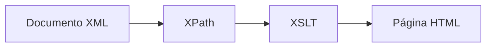

# HTML básico para transformaciones XSLT

## ¿Por qué necesitamos HTML?

Uno de los usos más habituales de XSLT consiste en transformar documentos XML en páginas HTML para poder visualizarlos desde un navegador web.

Por este motivo, antes de comenzar a trabajar con hojas de estilo XSLT, es conveniente repasar la estructura básica de un documento HTML.

!!! info "Idea clave"
    XPath permite localizar información dentro de un documento XML.

    XSLT utiliza esa información para generar una salida, que frecuentemente será una página HTML.

---

## El papel de HTML en las transformaciones

El proceso habitual es el siguiente:



En este proceso:

- XML almacena los datos.
- XPath localiza la información.
- XSLT transforma los datos.
- HTML muestra el resultado en el navegador.

---

## Estructura mínima de un documento HTML

Todo documento HTML debe tener una estructura básica como la siguiente:

```html
<!DOCTYPE html>

<html>

<head>

    <meta charset="UTF-8">

    <title>Mi página web</title>

</head>

<body>

    <h1>Título principal</h1>

    <p>Contenido de la página</p>

</body>

</html>
```

---

## Elementos principales

### DOCTYPE

Indica al navegador que el documento utiliza HTML5.

```html
<!DOCTYPE html>
```

---

### Elemento html

Contiene todo el contenido de la página.

```html
<html>
...
</html>
```

---

### Elemento head

Incluye información sobre el documento.

```html
<head>
```

Dentro de este bloque suelen encontrarse:

- El título de la página.
- La codificación de caracteres.
- Hojas de estilo CSS.
- Scripts JavaScript.

---

### Elemento body

Contiene el contenido visible para el usuario.

```html
<body>
```

Todo aquello que aparece en la ventana del navegador se encuentra dentro de este elemento.

---

## Encabezados

Los encabezados permiten organizar la información.

HTML dispone de seis niveles:

```html
<h1>Encabezado principal</h1>

<h2>Encabezado secundario</h2>

<h3>Encabezado de tercer nivel</h3>
```

Resultado:

# Encabezado principal

## Encabezado secundario

### Encabezado de tercer nivel

---

## Párrafos

Los párrafos se crean mediante la etiqueta:

```html
<p>
```

Ejemplo:

```html
<p>Este es un párrafo.</p>
```

Resultado:

Este es un párrafo.

---

## Saltos de línea

La etiqueta:

```html
<br>
```

permite insertar un salto de línea.

Ejemplo:

```html
Primera línea<br>
Segunda línea
```

---

## Listas

### Lista no ordenada

```html
<ul>

    <li>XML</li>

    <li>XPath</li>

    <li>XSLT</li>

</ul>
```

Resultado:

- XML
- XPath
- XSLT

---

### Lista ordenada

```html
<ol>

    <li>Crear XML</li>

    <li>Consultar XPath</li>

    <li>Transformar con XSLT</li>

</ol>
```

Resultado:

1. Crear XML
2. Consultar XPath
3. Transformar con XSLT

---

## Tablas HTML

Las tablas son uno de los elementos más utilizados en transformaciones XSLT.

Muchas veces un documento XML se convierte en una tabla para facilitar su visualización.

---

### Estructura básica

```html
<table border="1">

    <tr>

        <th>Título</th>
        <th>Director</th>

    </tr>

    <tr>

        <td>Casablanca</td>
        <td>Michael Curtiz</td>

    </tr>

</table>
```

---

### Significado de las etiquetas

| Etiqueta | Función |
|-----------|----------|
| `<table>` | Tabla |
| `<tr>` | Fila |
| `<th>` | Encabezado de columna |
| `<td>` | Celda de datos |

---

### Resultado visual

| Título | Director |
|---------|----------|
| Casablanca | Michael Curtiz |

---

## Ejemplo completo

Supongamos que disponemos del siguiente XML:

```xml
<pelicula>

    <titulo>Casablanca</titulo>

    <director>Michael Curtiz</director>

</pelicula>
```

Una transformación XSLT podría generar:

```html
<html>

<body>

    <h1>Filmoteca</h1>

    <p>Título: Casablanca</p>

    <p>Director: Michael Curtiz</p>

</body>

</html>
```

El navegador mostraría:

```text
Filmoteca

Título: Casablanca

Director: Michael Curtiz
```

---

## HTML generado por XSLT

Cuando trabajemos con XSLT será muy frecuente encontrar estructuras como esta:

```xml
<xsl:template match="/">

<html>

<body>

<h1>Listado de películas</h1>

</body>

</html>

</xsl:template>
```

Observa que XSLT permite mezclar:

- Instrucciones XSLT (`xsl:template`).
- Etiquetas HTML (`html`, `body`, `h1`).

El resultado final será una página web HTML.

---

# Actividades prácticas

??? question "Actividad 1. Identificando elementos HTML"

    Observa el siguiente documento:

    ```html
    <!DOCTYPE html>

    <html>

    <head>

        <title>Mi página</title>

    </head>

    <body>

        <h1>Bienvenido</h1>

        <p>Primer párrafo.</p>

    </body>

    </html>
    ```

    Indica:

    1. El elemento raíz.
    2. El contenido del elemento `head`.
    3. El contenido del elemento `body`.
    4. El encabezado principal.

    ??? success "Ver solución"

        **1. Elemento raíz**

        ```html
        <html>
        ```

        **2. Contenido del head**

        ```html
        <title>Mi página</title>
        ```

        **3. Contenido del body**

        ```html
        <h1>Bienvenido</h1>

        <p>Primer párrafo.</p>
        ```

        **4. Encabezado principal**

        ```html
        <h1>Bienvenido</h1>
        ```

---

??? question "Actividad 2. Construyendo una página HTML"

    Crea una página HTML que contenga:

    - Un encabezado principal.
    - Dos párrafos.
    - Una lista con tres elementos.

    ??? success "Ver solución"

        ```html
        <!DOCTYPE html>

        <html>

        <head>

            <meta charset="UTF-8">

            <title>Ejemplo HTML</title>

        </head>

        <body>

            <h1>Lenguajes de Marcas</h1>

            <p>Primer párrafo.</p>

            <p>Segundo párrafo.</p>

            <ul>

                <li>XML</li>
                <li>XPath</li>
                <li>XSLT</li>

            </ul>

        </body>

        </html>
        ```

---

??? question "Actividad 3. Creando una tabla"

    Construye una tabla con dos columnas:

    - Título
    - Director

    y dos películas.

    ??? success "Ver solución"

        ```html
        <table border="1">

            <tr>

                <th>Título</th>
                <th>Director</th>

            </tr>

            <tr>

                <td>Casablanca</td>
                <td>Michael Curtiz</td>

            </tr>

            <tr>

                <td>The Apartment</td>
                <td>Billy Wilder</td>

            </tr>

        </table>
        ```

---

??? question "Reto final"

    Diseña una página HTML que muestre:

    - Título de la filmoteca.
    - Una tabla con dos películas.
    - Nombre del director de cada película.

    ??? success "Ver solución"

        ```html
        <!DOCTYPE html>

        <html>

        <head>

            <meta charset="UTF-8">

            <title>Filmoteca</title>

        </head>

        <body>

            <h1>Filmoteca</h1>

            <table border="1">

                <tr>

                    <th>Título</th>
                    <th>Director</th>

                </tr>

                <tr>

                    <td>Casablanca</td>
                    <td>Michael Curtiz</td>

                </tr>

                <tr>

                    <td>The Apartment</td>
                    <td>Billy Wilder</td>

                </tr>

            </table>

        </body>

        </html>
        ```

---

# Resumen

!!! success "Ideas clave"

    - HTML es el formato de salida más habitual en transformaciones XSLT.
    - Todo documento HTML se organiza mediante los elementos `html`, `head` y `body`.
    - Los encabezados permiten estructurar el contenido.
    - Los párrafos presentan información textual.
    - Las listas organizan elementos relacionados.
    - Las tablas son fundamentales para mostrar datos XML transformados.
    - XSLT genera habitualmente documentos HTML a partir de los datos almacenados en XML.