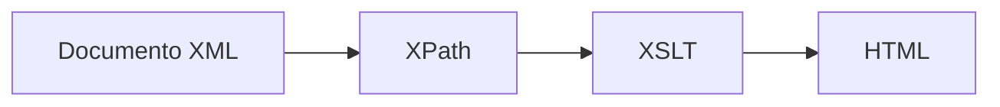

# Introducción a XPath y XSLT

## Presentación

Durante las unidades anteriores hemos aprendido a crear documentos XML bien formados y a validar su estructura mediante DTD y XML Schema (XSD). Gracias a estas tecnologías podemos garantizar que los datos almacenados cumplen unas reglas determinadas y mantienen una estructura coherente.

Sin embargo, en aplicaciones reales no basta con almacenar y validar información. También es necesario:

- Localizar datos concretos dentro de documentos XML.
- Filtrar información según determinados criterios.
- Extraer únicamente los datos que necesitamos.
- Transformar documentos XML en otros formatos.
- Generar automáticamente páginas web a partir de los datos almacenados.

Para cubrir estas necesidades existen dos tecnologías fundamentales:

- **XPath (XML Path Language)**: permite navegar por un documento XML y seleccionar elementos, atributos o contenidos concretos.
- **XSLT (Extensible Stylesheet Language Transformations)**: permite transformar un documento XML en otro formato, como HTML, texto plano u otro documento XML.

Ambas tecnologías trabajan habitualmente de forma conjunta y constituyen una de las herramientas más potentes para el procesamiento de información estructurada.

---

## Situación de partida

Imagina que disponemos del siguiente documento XML:

```xml
<biblioteca>

    <libro categoria="programacion">
        <titulo>Introducción a XML</titulo>
        <autor>Ana Pérez</autor>
        <anio>2023</anio>
    </libro>

    <libro categoria="bases-de-datos">
        <titulo>Fundamentos de SQL</titulo>
        <autor>Carlos López</autor>
        <anio>2022</anio>
    </libro>

</biblioteca>
```

Este documento contiene información válida y estructurada, pero pueden surgir preguntas como las siguientes:

- ¿Cómo obtener únicamente los títulos?
- ¿Cómo seleccionar los libros de programación?
- ¿Cómo contar cuántos libros existen?
- ¿Cómo generar una página HTML con esta información?
- ¿Cómo ordenar los libros por título o por fecha?

XPath y XSLT proporcionan la respuesta a todas estas cuestiones.

---

## XPath: encontrando información en XML

!!! info "¿Qué es XPath?"

    XPath es un lenguaje diseñado para localizar nodos dentro de un documento XML.

Puede compararse con un sistema GPS para documentos XML.

Si XML almacena la información, XPath permite encontrar exactamente dónde se encuentra cada dato.

---

## XSLT: transformando información

!!! info "¿Qué es XSLT?"

    XSLT es un lenguaje de transformación que permite convertir documentos XML en otros formatos.

Su uso más habitual consiste en generar páginas HTML automáticamente a partir de los datos almacenados en XML.

---

## Cómo trabajan conjuntamente XPath y XSLT



---

## Qué aprenderás en esta unidad

- Comprender la estructura jerárquica de los documentos XML.
- Utilizar rutas XPath para acceder a la información.
- Emplear ejes, predicados y funciones XPath.
- Construir consultas XPath complejas.
- Entender el funcionamiento de una transformación XSLT.
- Crear plantillas de transformación.
- Generar documentos HTML a partir de XML.

---

## Resumen

!!! success "Idea clave"

    XML permite almacenar información estructurada.

    XPath permite localizar información dentro del documento.

    XSLT permite transformar esa información y presentarla en otros formatos.
