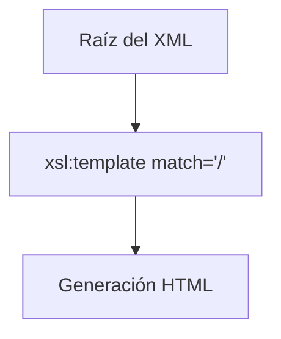
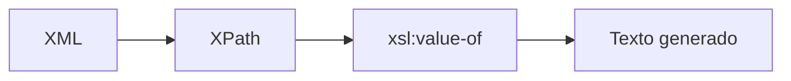
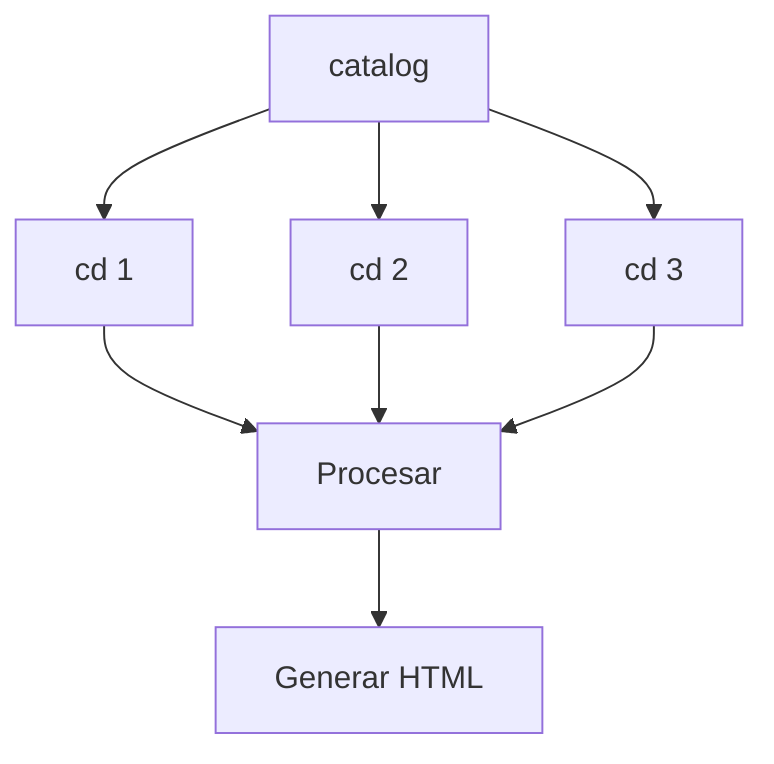
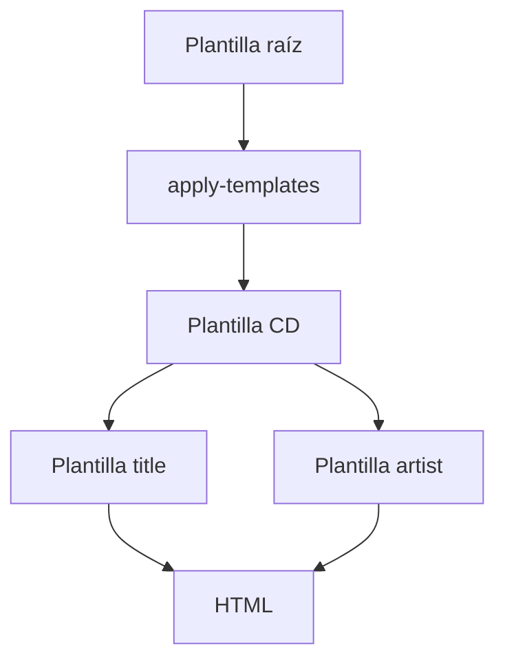

# Templates y procesamiento en XSLT

## Introducción

En la página anterior hemos visto cómo funciona una transformación XSLT y cuáles son sus elementos principales.

Ahora vamos a estudiar las instrucciones más importantes de XSLT, que son las que realmente permiten procesar la información contenida en un documento XML.

Las más utilizadas son:

- `xsl:template`
- `xsl:value-of`
- `xsl:for-each`
- `xsl:apply-templates`

Estas instrucciones constituyen la base de prácticamente cualquier transformación XSLT.

!!! info "Idea clave"
    XSLT utiliza XPath para localizar los datos y posteriormente aplica reglas para generar el documento de salida.

---

## Documento XML de ejemplo

Utilizaremos durante todo el tema el siguiente catálogo de CDs:

```xml
<?xml version="1.0" encoding="UTF-8"?>

<catalog>

    <cd>

        <title>Empire Burlesque</title>

        <artist>Bob Dylan</artist>

        <company>Columbia</company>

        <price>10.90</price>

        <year>1985</year>

    </cd>

    <cd>

        <title>Hide your heart</title>

        <artist>Bonnie Tyler</artist>

        <company>CBS Records</company>

        <price>9.90</price>

        <year>1988</year>

    </cd>

    <cd>

        <title>Greatest Hits</title>

        <artist>Dolly Parton</artist>

        <company>RCA</company>

        <price>9.90</price>

        <year>1982</year>

    </cd>

</catalog>
```

---

## xsl:template

## ¿Qué es una plantilla?

Una plantilla define una regla de transformación.

Cuando XPath encuentra un nodo que coincide con el criterio especificado en el atributo `match`, se ejecuta la plantilla correspondiente.

---

## Sintaxis básica

```xml
<xsl:template match="expresionXPath">

</xsl:template>
```

---

## Plantilla principal

La plantilla más habitual es:

```xml
<xsl:template match="/">
```

Esta plantilla se aplica a la raíz del documento XML.

---

## Ejemplo

```xml
<xsl:template match="/">

    <html>

        <body>

            <h1>Mi colección de CDs</h1>

        </body>

    </html>

</xsl:template>
```

Resultado:

```html
<h1>Mi colección de CDs</h1>
```

---

## Funcionamiento visual



---

## xsl:value-of

### ¿Para qué sirve?

Permite extraer el valor de un elemento XML y copiarlo en el documento generado.

Es probablemente la instrucción más utilizada en XSLT.

---

### Sintaxis

```xml
<xsl:value-of select="expresionXPath"/>
```

---

### Ejemplo básico

```xml
<xsl:value-of select="catalog/cd/title"/>
```

Resultado:

```text
Empire Burlesque
```

---

### Ejemplo completo

```xml
<xsl:template match="/">

<html>

<body>

<h2>Mi colección de CDs</h2>

<p>

<xsl:value-of select="catalog/cd/title"/>

</p>

</body>

</html>

</xsl:template>
```

Resultado:

```html
<h2>Mi colección de CDs</h2>

<p>Empire Burlesque</p>
```

---

### Cómo funciona



---

## xsl:for-each

### ¿Para qué sirve?

Permite recorrer una colección de elementos XML.

Equivale a un bucle que se ejecuta una vez por cada elemento seleccionado.

---

### Sintaxis

```xml
<xsl:for-each select="expresionXPath">

</xsl:for-each>
```

---

### Ejemplo básico

```xml
<xsl:for-each select="catalog/cd">

    <p>

        <xsl:value-of select="title"/>

    </p>

</xsl:for-each>
```

---

### Resultado

```html
<p>Empire Burlesque</p>

<p>Hide your heart</p>

<p>Greatest Hits</p>
```

---

### Ejemplo completo con tabla

```xml
<xsl:for-each select="catalog/cd">

<tr>

    <td>
        <xsl:value-of select="title"/>
    </td>

    <td>
        <xsl:value-of select="artist"/>
    </td>

</tr>

</xsl:for-each>
```

Resultado:

| Título | Artista |
|---------|----------|
| Empire Burlesque | Bob Dylan |
| Hide your heart | Bonnie Tyler |
| Greatest Hits | Dolly Parton |

---

## Funcionamiento visual



---

## xsl:apply-templates

### ¿Para qué sirve?

Permite delegar el procesamiento en otras plantillas.

En lugar de escribir todo el código dentro de un bucle, el procesador busca automáticamente la plantilla adecuada para cada nodo.

---

### Plantilla principal

```xml
<xsl:template match="/">

<html>

<body>

<h2>My CD Collection</h2>

<xsl:apply-templates/>

</body>

</html>

</xsl:template>
```

---

### Plantilla para cada CD

```xml
<xsl:template match="cd">

<p>

<xsl:apply-templates select="title"/>

<xsl:apply-templates select="artist"/>

</p>

</xsl:template>
```

---

### Plantilla para títulos

```xml
<xsl:template match="title">

    Title:

    <span style="color:red">

        <xsl:value-of select="."/>

    </span>

</xsl:template>
```

---

### Plantilla para artistas

```xml
<xsl:template match="artist">

    Artist:

    <span style="color:green">

        <xsl:value-of select="."/>

    </span>

</xsl:template>
```

---

### Flujo de ejecución



---

### Diferencia entre for-each y apply-templates

| xsl:for-each | xsl:apply-templates |
|--------------|---------------------|
| Control manual | Procesamiento automático |
| Más sencillo | Más modular |
| Ideal para tablas | Ideal para proyectos grandes |
| Todo el código suele estar junto | El código se distribuye entre varias plantillas |

---

## Comparación práctica

### Con for-each

```xml
<xsl:for-each select="catalog/cd">

<p>

<xsl:value-of select="title"/>

</p>

</xsl:for-each>
```

---

### Con apply-templates

```xml
<xsl:apply-templates select="cd"/>
```

junto con:

```xml
<xsl:template match="cd">

<p>

<xsl:value-of select="title"/>

</p>

</xsl:template>
```

Ambos producen el mismo resultado.

---

## Resumen de instrucciones

| Instrucción | Función |
|-------------|----------|
| `xsl:template` | Define reglas de transformación |
| `xsl:value-of` | Extrae el valor de un nodo |
| `xsl:for-each` | Recorre colecciones |
| `xsl:apply-templates` | Aplica otras plantillas |

---

## Actividades prácticas

??? question "Actividad 1. Identificando instrucciones"

    Indica para qué sirve cada una de las siguientes instrucciones:

    ```xml
    <xsl:template>
    ```

    ```xml
    <xsl:value-of>
    ```

    ```xml
    <xsl:for-each>
    ```

    ```xml
    <xsl:apply-templates>
    ```

    ??? success "Ver solución"

        | Instrucción | Función |
        |-------------|----------|
        | `xsl:template` | Define una plantilla de transformación |
        | `xsl:value-of` | Obtiene el valor de un nodo XML |
        | `xsl:for-each` | Recorre varios elementos |
        | `xsl:apply-templates` | Aplica otras plantillas automáticamente |

---

??? question "Actividad 2. Utilizando xsl:value-of"

    Escribe la instrucción necesaria para mostrar el título de un CD.

    ??? success "Ver solución"

        ```xml
        <xsl:value-of select="title"/>
        ```

---

??? question "Actividad 3. Utilizando xsl:for-each"

    Escribe un fragmento XSLT que recorra todos los elementos `cd`.

    ??? success "Ver solución"

        ```xml
        <xsl:for-each select="catalog/cd">

            <xsl:value-of select="title"/>

        </xsl:for-each>
        ```

---

??? question "Actividad 4. Plantillas"

    ¿Qué nodo procesa la siguiente plantilla?

    ```xml
    <xsl:template match="/">
    ```

    ??? success "Ver solución"

        Procesa la raíz del documento XML.

        El carácter:

        ```xpath
        /
        ```

        representa el nodo raíz.

---

??? question "Reto final"

    Explica las diferencias principales entre:

    - `xsl:for-each`
    - `xsl:apply-templates`

    e indica cuándo utilizarías cada uno.

    ??? success "Ver solución"

        **xsl:for-each**

        - Recorre explícitamente una colección.
        - El programador controla completamente el procesamiento.
        - Es ideal para ejemplos sencillos y tablas.

        **xsl:apply-templates**

        - Delega el procesamiento en otras plantillas.
        - Hace el código más modular.
        - Es más adecuado para proyectos complejos y reutilizables.

        En proyectos pequeños suele utilizarse `for-each`.

        En transformaciones grandes y organizadas suele preferirse `apply-templates`.

---

## Resumen

!!! success "Ideas clave"

    - `xsl:template` define reglas de transformación.
    - `match="/"` identifica la plantilla principal.
    - `xsl:value-of` permite extraer valores de un documento XML.
    - `xsl:for-each` recorre colecciones de elementos.
    - `xsl:apply-templates` permite delegar el procesamiento en otras plantillas.
    - Tanto `for-each` como `apply-templates` pueden producir resultados similares, pero siguen enfoques diferentes.
    - Estas instrucciones constituyen la base de la mayoría de las transformaciones XSLT.