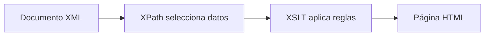

# Transformación XML → HTML

## Integrando todos los conocimientos de la unidad

Durante esta unidad hemos aprendido a:

- Navegar por documentos XML mediante XPath.
- Utilizar predicados, funciones y operadores.
- Crear consultas XPath complejas.
- Comprender la estructura básica de HTML.
- Construir hojas de transformación XSLT.
- Utilizar plantillas, bucles, condiciones y ordenaciones.

Ahora vamos a integrar todos estos conocimientos en una transformación completa capaz de convertir un documento XML en una página HTML visualizable desde cualquier navegador.

!!! success "Objetivo de la página"
    Ser capaz de diseñar y comprender una transformación completa XML → HTML utilizando todas las herramientas estudiadas durante la unidad.

---

# El proceso completo de transformación

La generación de páginas web mediante XSLT sigue siempre el mismo flujo:



En este proceso:

- XML almacena los datos.
- XPath localiza la información.
- XSLT aplica reglas de transformación.
- HTML presenta el resultado al usuario.

---

# Documento XML original

El siguiente documento contiene información sobre películas.

```xml
<?xml version="1.0" encoding="UTF-8"?>

<?xml-stylesheet
 type="text/xsl"
 href="filmoteca.xsl"?>

<filmoteca>

    <pelicula estreno="1942">

        <titulo>Casablanca</titulo>

        <director>Michael Curtiz</director>

        <valoracion>9</valoracion>

    </pelicula>

    <pelicula estreno="1960">

        <titulo>The Apartment</titulo>

        <director>Billy Wilder</director>

        <valoracion>8</valoracion>

    </pelicula>

    <pelicula estreno="1972">

        <titulo>El Padrino</titulo>

        <director>Francis Ford Coppola</director>

        <valoracion>10</valoracion>

    </pelicula>

</filmoteca>
```

---

## Asociación XML ↔ XSLT

La instrucción:

```xml
<?xml-stylesheet
 type="text/xsl"
 href="filmoteca.xsl"?>
```

indica que existe una hoja XSLT denominada:

```text
filmoteca.xsl
```

que deberá utilizarse para transformar el documento XML.

---

# Resultado que queremos obtener

Queremos generar una página HTML similar a la siguiente:

| Título | Director | Estreno | Valoración |
|---------|---------|---------|---------|
| Casablanca | Michael Curtiz | 1942 | Excelente (9) |
| El Padrino | Francis Ford Coppola | 1972 | Excelente (10) |
| The Apartment | Billy Wilder | 1960 | 8 |

Además:

✅ Las películas deben aparecer ordenadas por título.

✅ Las valoraciones superiores a 8 deben destacarse.

✅ Debe mostrarse el número total de películas.

---

# Hoja XSLT completa

```xml
<?xml version="1.0" encoding="UTF-8"?>

<xsl:stylesheet
 version="1.0"
 xmlns:xsl="http://www.w3.org/1999/XSL/Transform">

<xsl:template match="/">

<html>

<head>

<title>Filmoteca</title>

</head>

<body>

<h1>Filmoteca</h1>

<table border="1">

<tr>

<th>Título</th>
<th>Director</th>
<th>Estreno</th>
<th>Valoración</th>

</tr>

<xsl:for-each select="filmoteca/pelicula">

    <xsl:sort select="titulo"/>

    <tr>

        <td>
            <xsl:value-of select="titulo"/>
        </td>

        <td>
            <xsl:value-of select="director"/>
        </td>

        <td>
            <xsl:value-of select="@estreno"/>
        </td>

        <td>

            <xsl:choose>

                <xsl:when test="valoracion > 8">

                    <span style="color:green;font-weight:bold">

                        Excelente
                        (<xsl:value-of select="valoracion"/>)

                    </span>

                </xsl:when>

                <xsl:otherwise>

                    <xsl:value-of select="valoracion"/>

                </xsl:otherwise>

            </xsl:choose>

        </td>

    </tr>

</xsl:for-each>

</table>

<p>

Número total de películas:

<xsl:value-of
 select="count(filmoteca/pelicula)"/>

</p>

</body>

</html>

</xsl:template>

</xsl:stylesheet>
```

---

# Analizando la transformación

## Paso 1. Plantilla principal

```xml
<xsl:template match="/">
```

La transformación comienza en la raíz del documento XML.

---

## Paso 2. Crear la página HTML

```html
<html>

<head>

<title>Filmoteca</title>

</head>

<body>
```

Estas etiquetas se copiarán directamente al documento HTML generado.

---

## Paso 3. Recorrer todas las películas

```xml
<xsl:for-each
 select="filmoteca/pelicula">
```

Permite procesar cada película individualmente.

---

## Paso 4. Ordenar el resultado

```xml
<xsl:sort select="titulo"/>
```

Antes de mostrar los datos, las películas se ordenan alfabéticamente.

Resultado:

```text
Casablanca
El Padrino
The Apartment
```

---

## Paso 5. Mostrar la información

```xml
<xsl:value-of select="titulo"/>
```

```xml
<xsl:value-of select="director"/>
```

```xml
<xsl:value-of select="@estreno"/>
```

Extraen los datos almacenados en el XML.

---

## Paso 6. Aplicar condiciones

```xml
<xsl:choose>
```

Permite distinguir entre películas destacadas y películas normales.

---

## Paso 7. Contar elementos

```xpath
count(filmoteca/pelicula)
```

Cuenta todas las películas presentes en el documento.

!!! info "Importante"

    La función:

    ```xpath
    count(filmoteca/pelicula)
    ```

    pertenece a XPath.

    Para mostrar el resultado dentro de XSLT utilizamos:

    ```xml
    <xsl:value-of
     select="count(filmoteca/pelicula)"/>
    ```

---

# Errores frecuentes

!!! danger "Olvidar xsl:value-of"

    El siguiente código:

    ```xml
    <td>titulo</td>
    ```

    mostrará literalmente:

    ```text
    titulo
    ```

    Lo correcto es:

    ```xml
    <td>

        <xsl:value-of select="titulo"/>

    </td>
    ```

---

!!! danger "Olvidar xsl:sort dentro del for-each"

    El siguiente código no ordenará correctamente:

    ```xml
    <xsl:sort select="titulo"/>
    ```

    si se encuentra fuera del bucle.

---

!!! danger "Confundir XPath y XSLT"

    XPath:

    ```xpath
    count(filmoteca/pelicula)
    ```

    XSLT:

    ```xml
    <xsl:value-of
     select="count(filmoteca/pelicula)"/>
    ```

---

# Práctica guiada

??? question "Práctica 1. Catálogo de videojuegos"

    Diseña una transformación XSLT que genere una tabla HTML a partir de un XML de videojuegos.

    Requisitos:

    - Mostrar título.
    - Mostrar empresa.
    - Mostrar valoración.
    - Ordenar por título.
    - Destacar valoraciones superiores a 8.

    ??? hint "Pista"

        Necesitarás:

        - `xsl:for-each`
        - `xsl:sort`
        - `xsl:value-of`
        - `xsl:choose`

    ??? success "Ver solución"

        Utiliza una estructura similar a:

        ```xml
        <xsl:for-each select="videojuegos/videojuego">

            <xsl:sort select="titulo"/>

            ...

        </xsl:for-each>
        ```

---

# Proyecto final de la unidad

??? question "Proyecto: Biblioteca digital"

    Diseña una transformación XSLT completa a partir de un XML de libros.

    El resultado HTML deberá incluir:

    - Título de la página.
    - Tabla de libros.
    - Autor.
    - Año de publicación.
    - Ordenación alfabética.
    - Destacar los libros publicados después de 2020.
    - Número total de libros.

    ### Criterios mínimos

    ✅ Generar HTML válido.

    ✅ Mostrar todos los libros.

    ✅ Utilizar `xsl:for-each`.

    ✅ Utilizar `xsl:sort`.

    ✅ Incorporar una estructura condicional.

    ✅ Mostrar el número total de libros.

    ✅ Generar correctamente una tabla HTML.

---

# Resumen

!!! success "Ideas clave"

    - XSLT permite transformar XML en HTML.
    - XPath selecciona la información que debe mostrarse.
    - `xsl:for-each` recorre colecciones de elementos.
    - `xsl:sort` permite ordenar los datos.
    - `xsl:value-of` extrae información del XML.
    - `xsl:choose` y `xsl:when` permiten aplicar condiciones.
    - `count()` permite obtener estadísticas simples.
    - La combinación de XML, XPath, XSLT y HTML permite generar páginas web dinámicas a partir de información estructurada.