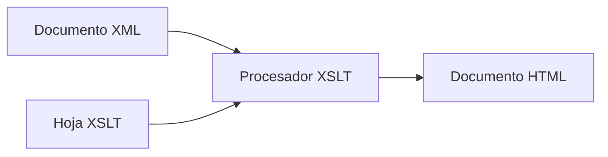
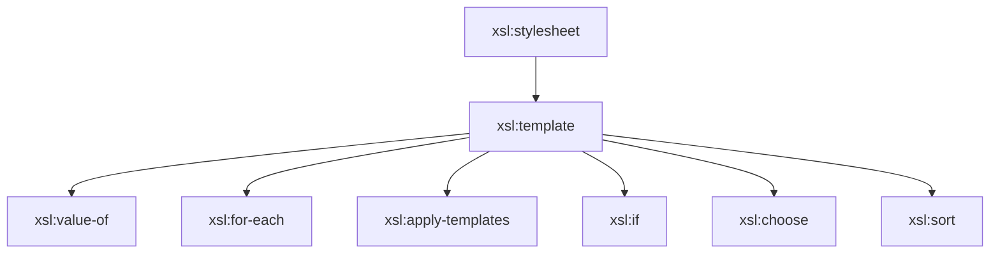
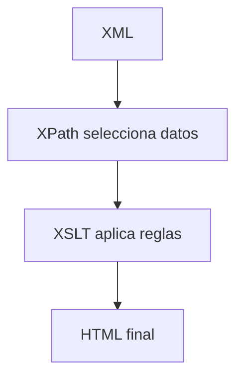

# Fundamentos de XSLT

## ¿Qué es XSLT?

Hasta ahora hemos aprendido a almacenar información en documentos XML y a consultarla mediante XPath.

Sin embargo, en muchas ocasiones no queremos visualizar directamente el XML, sino transformarlo en un formato más adecuado para el usuario.

Para ello utilizamos **XSLT** (*eXtensible Stylesheet Language Transformations*).

XSLT es un lenguaje diseñado para transformar documentos XML en otros formatos, como:

- HTML.
- XML con otra estructura.
- Texto plano.
- Otros formatos estructurados.

!!! info "Idea clave"
    XPath localiza la información.

    XSLT utiliza esa información para generar un nuevo documento.

---

## ¿Por qué utilizar XSLT?

Supongamos el siguiente XML:

```xml
<pelicula>

    <titulo>Casablanca</titulo>

    <director>Michael Curtiz</director>

</pelicula>
```

La información es correcta, pero no resulta especialmente cómoda de visualizar.

Mediante XSLT podemos generar automáticamente una página HTML como la siguiente:

```html
<h1>Casablanca</h1>

<p>Director: Michael Curtiz</p>
```

El resultado será mucho más fácil de interpretar para el usuario.

---

# El proceso de transformación

Una transformación XSLT necesita tres elementos:

1. Documento XML de origen.
2. Hoja de estilo XSLT.
3. Procesador XSLT.

---

## Esquema general



---

## Ejemplo

### Documento XML

```xml
<alumno>

    <nombre>Ana</nombre>

</alumno>
```

### Hoja XSLT

```xml
<xsl:value-of select="alumno/nombre"/>
```

### Resultado

```html
Ana
```

---

## ¿Qué hace realmente XSLT?

Durante la transformación:

1. El procesador lee el documento XML.
2. Lee las reglas definidas en el archivo XSLT.
3. Aplica esas reglas utilizando XPath.
4. Genera un nuevo documento de salida.

---

# Estructura básica de una hoja XSLT

Una hoja XSLT también es un documento XML.

Por tanto:

- Debe estar bien formada.
- Utiliza etiquetas XML.
- Tiene un elemento raíz.

---

## Estructura mínima

```xml
<?xml version="1.0" encoding="UTF-8"?>

<xsl:stylesheet
    version="1.0"
    xmlns:xsl="http://www.w3.org/1999/XSL/Transform">

</xsl:stylesheet>
```

---

## Elemento xsl:stylesheet

Es el elemento raíz de toda hoja XSLT.

```xml
<xsl:stylesheet>
```

Dentro de este elemento se escriben todas las reglas de transformación.

---

### Atributo version

Indica la versión de XSLT utilizada.

```xml
version="1.0"
```

---

### Namespace de XSLT

```xml
xmlns:xsl="http://www.w3.org/1999/XSL/Transform"
```

Permite identificar las etiquetas propias de XSLT.

Gracias a ello el procesador puede distinguir entre:

```xml
<xsl:template>
```

e instrucciones HTML como:

```html
<table>
```

---

# La plantilla principal

Toda transformación suele comenzar con una plantilla principal.

```xml
<xsl:template match="/">
```

---

## Significado de /

El carácter:

```xpath
/
```

representa la raíz del documento XML.

Cuando el procesador encuentra:

```xml
<xsl:template match="/">
```

comienza la transformación desde el nodo raíz.

---

## Ejemplo completo

```xml
<?xml version="1.0" encoding="UTF-8"?>

<xsl:stylesheet
 version="1.0"
 xmlns:xsl="http://www.w3.org/1999/XSL/Transform">

    <xsl:template match="/">

        <html>

            <body>

                <h1>Mi primera transformación</h1>

            </body>

        </html>

    </xsl:template>

</xsl:stylesheet>
```

---

## Resultado generado

```html
<html>

<body>

<h1>Mi primera transformación</h1>

</body>

</html>
```

---

# Mezclando XSLT y HTML

Una de las características más importantes de XSLT es que permite combinar:

- Instrucciones XSLT.
- Etiquetas HTML.

Por ejemplo:

```xml
<xsl:template match="/">

<html>

<body>

    <h1>Filmoteca</h1>

</body>

</html>

</xsl:template>
```

En este código:

```xml
<xsl:template>
```

pertenece a XSLT.

Mientras que:

```html
<html>
<body>
<h1>
```

pertenecen a HTML.

---

# Principales elementos de XSLT

A lo largo de la unidad trabajaremos con los siguientes elementos:

| Elemento | Función |
|-----------|-----------|
| `xsl:template` | Define plantillas |
| `xsl:value-of` | Obtiene valores |
| `xsl:for-each` | Recorre elementos |
| `xsl:apply-templates` | Aplica plantillas |
| `xsl:if` | Introduce condiciones |
| `xsl:choose` | Selección múltiple |
| `xsl:sort` | Ordena resultados |

---

## Vista global



---

# Relación entre XPath y XSLT

XPath y XSLT trabajan conjuntamente.

XSLT necesita XPath para localizar los datos que deben aparecer en el documento final.

Por ejemplo:

```xml
<xsl:value-of
    select="filmoteca/pelicula/titulo"/>
```

La expresión:

```xpath
filmoteca/pelicula/titulo
```

es XPath.

Mientras que:

```xml
<xsl:value-of>
```

es una instrucción XSLT.

---

# Flujo completo de transformación



---

# Actividades prácticas

??? question "Actividad 1. Identificando elementos"

    Observa el siguiente código:

    ```xml
    <xsl:stylesheet
     version="1.0"
     xmlns:xsl="http://www.w3.org/1999/XSL/Transform">

    </xsl:stylesheet>
    ```

    Indica:

    1. El elemento raíz.
    2. La versión de XSLT utilizada.
    3. El namespace empleado.

    ??? success "Ver solución"

        **1. Elemento raíz**

        ```xml
        <xsl:stylesheet>
        ```

        **2. Versión**

        ```text
        1.0
        ```

        **3. Namespace**

        ```xml
        http://www.w3.org/1999/XSL/Transform
        ```

---

??? question "Actividad 2. Interpretando una plantilla"

    Analiza el siguiente código:

    ```xml
    <xsl:template match="/">

        <html>

            <body>

                <h1>Bienvenido</h1>

            </body>

        </html>

    </xsl:template>
    ```

    Responde:

    1. ¿Qué nodo selecciona la plantilla?
    2. ¿Qué documento se genera?
    3. ¿Qué etiqueta HTML se visualizará?

    ??? success "Ver solución"

        **1. Nodo seleccionado**

        ```xpath
        /
        ```

        La raíz del documento.

        **2. Documento generado**

        Un documento HTML.

        **3. Etiqueta visible**

        ```html
        <h1>Bienvenido</h1>
        ```

---

??? question "Actividad 3. Identificando tecnologías"

    Indica qué elementos pertenecen a XSLT y cuáles a HTML:

    ```xml
    <xsl:template>

    <html>

    <body>

    <table>

    <xsl:value-of>

    </xsl:template>
    ```

    ??? success "Ver solución"

        **XSLT**

        ```xml
        <xsl:template>

        <xsl:value-of>
        ```

        **HTML**

        ```html
        <html>

        <body>

        <table>
        ```

---

??? question "Reto final"

    Explica con tus palabras el proceso completo que sigue una transformación XSLT desde que recibe un documento XML hasta que genera una página HTML.

    ??? success "Ver solución"

        1. El procesador lee el documento XML.
        2. Lee la hoja de estilo XSLT.
        3. Aplica las reglas definidas en las plantillas.
        4. Utiliza expresiones XPath para localizar los datos.
        5. Genera el documento HTML.
        6. El navegador muestra el resultado al usuario.

        En resumen:

        ```text
        XML
          ↓
        XPath
          ↓
        XSLT
          ↓
        HTML
        ```

---

# Resumen

!!! success "Ideas clave"

    - XSLT permite transformar documentos XML en otros formatos.
    - La salida más habitual es HTML.
    - Toda transformación necesita un XML, una hoja XSLT y un procesador XSLT.
    - El elemento raíz de una hoja XSLT es `xsl:stylesheet`.
    - La transformación suele comenzar en `xsl:template match="/"`.
    - XSLT utiliza XPath para localizar información.
    - Las instrucciones XSLT pueden mezclarse con etiquetas HTML.
    - Los elementos más importantes son `template`, `value-of`, `for-each`, `apply-templates`, `if`, `choose` y `sort`.