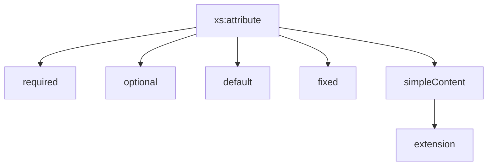

## 8. Declaración de atributos

Hasta ahora hemos trabajado con elementos XML que almacenan información mediante etiquetas.

Sin embargo, XML también permite almacenar información mediante atributos.

Observa el siguiente ejemplo:

```xml
<libro isbn="9788441532102">

    <titulo>XML Avanzado</titulo>

</libro>
```

En este caso:

- `libro` es un elemento.
- `isbn` es un atributo.
- `9788441532102` es el valor del atributo.

Los atributos suelen utilizarse para almacenar información descriptiva o complementaria sobre un elemento.

XML Schema permite definir y controlar atributos mediante la etiqueta:

```xml
<xs:attribute>
```

## 8.1 ¿Qué es un atributo?

Un atributo representa una propiedad asociada a un elemento.

Por ejemplo:

```xml
<usuario id="U001">
```

Aquí:

- `usuario` es el elemento.
- `id` es el atributo.
- `U001` es el valor del atributo.

Otro ejemplo:

```xml
<precio moneda="EUR">29.95</precio>
```

En este caso:

- `precio` contiene el valor principal.
- `moneda` aporta información adicional.

!!! note "Idea clave"

    Los atributos permiten añadir información descriptiva a un elemento XML sin necesidad de crear nuevas etiquetas.

## 8.2 Definiendo atributos con xs:attribute

La sintaxis básica es:

```xml
<xs:attribute
    name="isbn"
    type="xs:string"/>
```

Donde:

- `name` indica el nombre del atributo.
- `type` indica su tipo de dato.

Los atributos se definen dentro del elemento al que pertenecen.

Ejemplo:

```xml
<xs:element name="libro">

    <xs:complexType>

        <xs:sequence>

            <xs:element
                name="titulo"
                type="xs:string"/>

        </xs:sequence>

        <xs:attribute
            name="isbn"
            type="xs:string"/>

    </xs:complexType>

</xs:element>
```

Este esquema permite documentos como:

```xml
<libro isbn="9788441532102">

    <titulo>XML Avanzado</titulo>

</libro>
```

## 8.3 Atributos obligatorios

Por defecto, los atributos son opcionales.

Si queremos que el atributo sea obligatorio utilizamos:

```xml
use="required"
```

Ejemplo:

```xml
<xs:attribute
    name="isbn"
    type="xs:string"
    use="required"/>
```

### XML válido

```xml
<libro isbn="9788441532102">

    <titulo>XML Avanzado</titulo>

</libro>
```

### XML inválido

```xml
<libro>

    <titulo>XML Avanzado</titulo>

</libro>
```

El documento es inválido porque falta el atributo obligatorio.

!!! warning "Importante"

    Todo atributo marcado como `required` debe aparecer obligatoriamente en el documento XML.

## 8.4 Atributos opcionales

Podemos indicar explícitamente que un atributo es opcional mediante:

```xml
use="optional"
```

Ejemplo:

```xml
<xs:attribute
    name="email"
    type="xs:string"
    use="optional"/>
```

### XML válido

```xml
<usuario email="usuario@email.com"/>
```

### XML válido

```xml
<usuario/>
```

Ambos documentos son correctos.

## 8.5 Valores por defecto

En ocasiones interesa que un atributo tome automáticamente un valor si no aparece en el XML.

Para ello utilizamos:

```xml
default
```

Ejemplo:

```xml
<xs:attribute
    name="idioma"
    type="xs:string"
    default="es"/>
```

### XML

```xml
<usuario/>
```

Durante el procesamiento se asumirá:

```xml
idioma="es"
```

aunque el atributo no aparezca explícitamente.

### XML válido

```xml
<usuario idioma="ca"/>
```

También es válido porque el valor por defecto solo se utiliza cuando el atributo no aparece.

## 8.6 Valores fijos

Cuando queremos que un atributo tenga siempre el mismo valor utilizamos:

```xml
fixed
```

Ejemplo:

```xml
<xs:attribute
    name="pais"
    type="xs:string"
    fixed="España"/>
```

### XML válido

```xml
<cliente pais="España"/>
```

### XML inválido

```xml
<cliente pais="Francia"/>
```

No es válido porque el valor definido no coincide con el establecido por el esquema.

!!! warning "Importante"

    Los atributos definidos mediante `fixed` no pueden tomar valores distintos.

## 8.7 Elementos con atributos

Un elemento puede contener simultáneamente:

- Elementos hijos.
- Atributos.

Ejemplo:

```xml
<producto codigo="PR001">

    <nombre>Portátil</nombre>

    <precio>799.95</precio>

</producto>
```

Para definirlo utilizamos:

```xml
<xs:element name="producto">

    <xs:complexType>

        <xs:sequence>

            <xs:element
                name="nombre"
                type="xs:string"/>

            <xs:element
                name="precio"
                type="xs:decimal"/>

        </xs:sequence>

        <xs:attribute
            name="codigo"
            type="xs:string"
            use="required"/>

    </xs:complexType>

</xs:element>
```
!!! tip "Aclaración"

    El elemento **`producto`** es un tipo complejo porque combina **elementos hijos** (`nombre` y `precio`) con un **atributo obligatorio** (`codigo`). Esto permite describir información más completa y estructurada en un documento XML.

## 8.8 Regla fundamental: complexType

Existe una regla muy importante en XML Schema:

!!! warning "Regla fundamental"

    Todo elemento que contenga atributos debe definirse mediante `xs:complexType`.

Por ejemplo:

```xml
<libro isbn="9788441532102">
```

requiere obligatoriamente:

```xml
<xs:complexType>
```

aunque el contenido del elemento sea sencillo.

## 8.9 Elementos simples con atributos

A veces necesitamos combinar:

- Un valor simple.
- Uno o varios atributos.

Ejemplo:

```xml
<precio moneda="EUR">29.95</precio>
```

Aquí:

- `29.95` es el contenido principal.
- `EUR` es un atributo.

Para definir este tipo de estructuras utilizamos:

```xml
<xs:simpleContent>
```

junto con:

```xml
<xs:extension>
```

### Ejemplo completo

```xml
<xs:element name="precio">

    <xs:complexType>

        <xs:simpleContent>

            <xs:extension base="xs:decimal">

                <xs:attribute
                    name="moneda"
                    type="xs:string"
                    use="required"/>

            </xs:extension>

        </xs:simpleContent>

    </xs:complexType>

</xs:element>
```
!!! info "Aclaración"

    Aunque `precio` contiene un único valor numérico, se ha definido como un tipo complejo porque necesita incorporar el atributo obligatorio `moneda`.

    Los elementos simples no pueden tener atributos. Por ello se utiliza `xs:simpleContent`, que permite ampliar un tipo simple (`xs:decimal`) añadiéndole atributos mediante `xs:extension`.

### XML válido

```xml
<precio moneda="EUR">29.95</precio>
```

### XML inválido

```xml
<precio>29.95</precio>
```

Porque falta el atributo obligatorio.

### ¿Qué hace xs:extension?

La etiqueta:

```xml
<xs:extension>
```

permite ampliar un tipo existente.

En este caso:

```xml
base="xs:decimal"
```

indica que el elemento seguirá siendo un número decimal, pero además tendrá el atributo `moneda`.

!!! tip "Recuerda"

    Siempre que se utilice `xs:extension` debe indicarse mediante el atributo `base` el tipo que se desea ampliar.

    ```xml
    <xs:extension base="TipoBase">
    ```

    Sin `base`, XML Schema no sabría cuál es el tipo original sobre el que se añaden nuevos atributos o elementos.

## 8.10 Resumen visual



## Ejercicios propuestos

### Ejercicio 1 · Atributo obligatorio

Define un atributo llamado `id` de tipo texto que sea obligatorio.

??? tip "Solución"

    ```xml
    <xs:attribute
        name="id"
        type="xs:string"
        use="required"/>
    ```

### Ejercicio 2 · Detectando errores

¿Es válido?

```xml
<libro>

    <titulo>XML Avanzado</titulo>

</libro>
```

si el esquema contiene:

```xml
<xs:attribute
    name="isbn"
    type="xs:string"
    use="required"/>
```

??? tip "Solución"

    No.

    Falta el atributo obligatorio `isbn`.

### Ejercicio 3 · Valor por defecto

Define un atributo `idioma` cuyo valor por defecto sea `es`.

??? tip "Solución"

    ```xml
    <xs:attribute
        name="idioma"
        type="xs:string"
        default="es"/>
    ```

### Ejercicio 4 · Valor fijo

Define un atributo `pais` cuyo valor siempre sea `España`.

??? tip "Solución"

    ```xml
    <xs:attribute
        name="pais"
        type="xs:string"
        fixed="España"/>
    ```

### Ejercicio 5 · Precio con moneda

Diseña el esquema necesario para:

```xml
<precio moneda="EUR">29.95</precio>
```

??? tip "Solución"

    ```xml
    <xs:element name="precio">
        <xs:complexType>
            <xs:simpleContent>
                <xs:extension base="xs:decimal">
                    <xs:attribute
                        name="moneda"
                        type="xs:string"
                        use="required"/>
                </xs:extension>
            </xs:simpleContent>
        </xs:complexType>
    </xs:element>
    ```

## Actividad de reflexión

!!! question "Piensa"

    ¿Por qué crees que XML dispone tanto de elementos como de atributos para almacenar información?

??? tip "Posible respuesta"

    Porque algunos datos forman parte del contenido principal del documento mientras que otros representan propiedades o características asociadas a esos datos.

!!! tip "Al terminar este apartado"

    Deberías ser capaz de definir atributos XML, distinguir entre atributos obligatorios y opcionales, utilizar valores por defecto y modelar elementos que combinan texto y atributos.