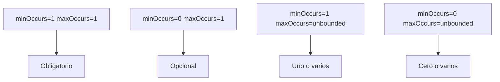

## 7. Cardinalidad: control de ocurrencias

Hasta ahora hemos aprendido a definir elementos simples y complejos utilizando XML Schema.

Sin embargo, todavía no hemos respondido a una pregunta fundamental:

> ¿Cuántas veces puede aparecer un elemento dentro de un documento XML?

XML Schema permite controlar este aspecto mediante los atributos:

```xml
minOccurs
maxOccurs
```

Estos atributos permiten indicar si un elemento es obligatorio, opcional o repetible.

## 7.1 ¿Qué es la cardinalidad?

La cardinalidad define el número mínimo y máximo de veces que puede aparecer un elemento dentro de otro.

!!! note "Idea clave"

    La cardinalidad indica cuántas veces puede aparecer un elemento en un documento XML.

## 7.2 Valores por defecto

Si no especificamos ninguna cardinalidad:

```xml
<xs:element name="titulo" type="xs:string"/>
```

XML Schema asume automáticamente:

```xml
minOccurs="1"
maxOccurs="1"
```

Esto significa que el elemento es obligatorio y debe aparecer exactamente una vez.

## 7.3 Elementos obligatorios

```xml
<xs:element
    name="titulo"
    type="xs:string"
    minOccurs="1"
    maxOccurs="1"/>
```

XML válido:

```xml
<titulo>XML Avanzado</titulo>
```

XML inválido:

```xml
<!-- Falta titulo -->
```

## 7.4 Elementos opcionales

```xml
<xs:element
    name="editorial"
    type="xs:string"
    minOccurs="0"
    maxOccurs="1"/>
```

Puede aparecer o no aparecer.

## 7.5 Elementos repetibles

```xml
<xs:element
    name="libro"
    minOccurs="1"
    maxOccurs="10"/>
```

Permite entre uno y diez elementos.

## 7.6 El valor unbounded

```xml
<xs:element
    name="libro"
    minOccurs="1"
    maxOccurs="unbounded"/>
```

Permite un número ilimitado de elementos.

## 7.7 Casos típicos de cardinalidad

| Cardinalidad | Significado |
| --- | --- |
| minOccurs="1" maxOccurs="1" | Exactamente una vez |
| minOccurs="0" maxOccurs="1" | Opcional |
| minOccurs="1" maxOccurs="unbounded" | Una o varias veces |
| minOccurs="0" maxOccurs="unbounded" | Cero o varias veces |

## 7.8 Ejemplo completo

```xml
<xs:element name="biblioteca">
    <xs:complexType>
        <xs:sequence>
            <xs:element
                name="libro"
                minOccurs="1"
                maxOccurs="unbounded"/>
        </xs:sequence>
    </xs:complexType>
</xs:element>
```

## 7.9 Resumen visual



## Ejercicios propuestos

### Ejercicio 1

¿Qué significa minOccurs="0" y maxOccurs="1"?

??? tip "Solución"
    El elemento es opcional y puede aparecer como máximo una vez.

### Ejercicio 2

¿Es válido un elemento definido con maxOccurs="2" si aparece tres veces?

??? tip "Solución"
    No.

### Ejercicio 3

Define un elemento comentario que pueda aparecer cero o varias veces.

??? tip "Solución"

    ```xml
    <xs:element name="comentario" minOccurs="0" maxOccurs="unbounded"/>
    ```

### Ejercicio 4

Configura libro para que sea obligatorio y repetible indefinidamente.

??? tip "Solución"

    ```xml
    <xs:element name="libro" minOccurs="1" maxOccurs="unbounded"/>
    ```

### Ejercicio 5

Diseña un elemento alumno que pueda aparecer entre 1 y 30 veces.

??? tip "Solución"

    ```xml
    <xs:element name="alumno" minOccurs="1" maxOccurs="30"/>
    ```

## Actividad de reflexión

!!! question "Piensa"

    ¿Por qué crees que XML Schema permite controlar el número mínimo y máximo de apariciones de un elemento?

!!! tip "Al terminar este apartado"

    Deberías ser capaz de utilizar minOccurs y maxOccurs para definir elementos obligatorios, opcionales y repetibles.
