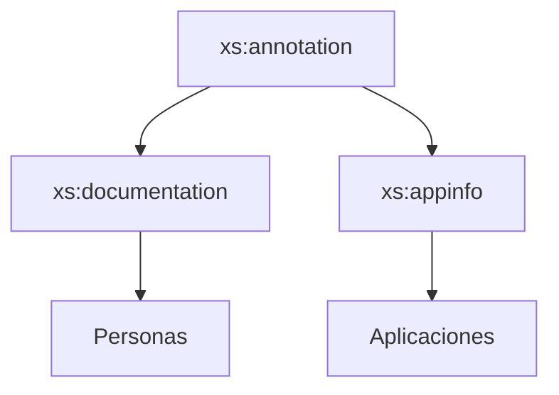

## 11. Documentación y comentarios en XML Schema

Hasta ahora hemos construido esquemas XSD capaces de definir estructuras complejas, validar datos y reutilizar componentes.

Sin embargo, existe un problema habitual en cualquier proyecto:

> Con el paso del tiempo resulta difícil recordar para qué sirve cada elemento, atributo o tipo definido.

Para resolver este problema, XML Schema incorpora mecanismos de documentación integrados.

Gracias a ellos podemos añadir explicaciones dentro del propio esquema.

## 11.1 ¿Por qué documentar un esquema?

Imagina el siguiente elemento:

```xml
<xs:element
    name="estado"
    type="xs:string"/>
```

Alguien que lea el esquema podría preguntarse:

- ¿Qué representa exactamente?
- ¿Qué valores admite?
- ¿Quién debe utilizarlo?

Sin documentación, es difícil responder a estas preguntas.

Con documentación adecuada:

```xml
<xs:annotation>

    <xs:documentation>

        Estado actual del pedido.

    </xs:documentation>

</xs:annotation>
```

la intención resulta mucho más clara.

!!! note "Idea clave"

    Un esquema bien documentado es más fácil de mantener, ampliar y reutilizar.

## 11.2 Comentarios XML tradicionales

Antes de estudiar la documentación específica de XML Schema, recuerda que XML permite comentarios mediante:

```xml
<!-- Comentario -->
```

Ejemplo:

```xml
<!-- Definición del cliente -->

<xs:element
    name="cliente"
    type="TipoCliente"/>
```

Estos comentarios ayudan a los desarrolladores.

Sin embargo:

- No forman parte de XML Schema.
- No pueden ser interpretados por herramientas especializadas.
- No están estructurados.

Por ello XML Schema incorpora mecanismos propios.

## 11.3 La etiqueta xs:annotation

Toda la documentación en XSD comienza mediante:

```xml
<xs:annotation>
```

Esta etiqueta actúa como contenedor.

Dentro de ella encontraremos principalmente:

- `xs:documentation`
- `xs:appinfo`

## 11.4 xs:documentation

La etiqueta más utilizada es:

```xml
<xs:documentation>
```

Permite incluir información dirigida a personas.

Ejemplo:

```xml
<xs:element name="email">

    <xs:annotation>

        <xs:documentation>

            Dirección de correo electrónico del usuario.

        </xs:documentation>

    </xs:annotation>

</xs:element>
```

La documentación puede ocupar varias líneas.

```xml
<xs:documentation>

    Identificador único del cliente.

    Debe coincidir con el valor
    almacenado en la base de datos.

</xs:documentation>
```

## 11.5 Documentando elementos

Es habitual documentar los elementos principales del esquema.

Ejemplo:

```xml
<xs:element name="pedido">

    <xs:annotation>

        <xs:documentation>

            Información completa de un pedido realizado por un cliente.

        </xs:documentation>

    </xs:annotation>

</xs:element>
```

## 11.6 Documentando atributos

Los atributos también deberían documentarse cuando su significado no sea evidente.

Ejemplo:

```xml
<xs:attribute
    name="estado">

    <xs:annotation>

        <xs:documentation>

            Estado actual del envío.

        </xs:documentation>

    </xs:annotation>

</xs:attribute>
```

## 11.7 Documentando tipos reutilizables

Una buena práctica consiste en documentar todos los tipos reutilizables.

Ejemplo:

```xml
<xs:complexType name="TipoPersona">

    <xs:annotation>

        <xs:documentation>

            Tipo base utilizado para representar personas.

        </xs:documentation>

    </xs:annotation>

</xs:complexType>
```

## 11.8 xs:appinfo

Además de documentación para personas, XML Schema permite almacenar información destinada a aplicaciones.

Para ello utilizamos:

```xml
<xs:appinfo>
```

Ejemplo:

```xml
<xs:annotation>

    <xs:appinfo>

        version=1.0

    </xs:appinfo>

</xs:annotation>
```

!!! note "Diferencia principal"

    `documentation` está orientado a personas.

    `appinfo` está orientado a programas.

## 11.9 Ejemplo completo

```xml
<xs:element name="cliente">

    <xs:annotation>

        <xs:documentation>

            Información de un cliente registrado.

        </xs:documentation>

    </xs:annotation>

    <xs:complexType>

        <xs:sequence>

            <xs:element
                name="nombre"
                type="xs:string"/>

            <xs:element
                name="email"
                type="xs:string"/>

        </xs:sequence>

    </xs:complexType>

</xs:element>
```

## 11.10 Buenas prácticas

### Documentar elementos importantes

✅ Recomendado

```xml
cliente
pedido
factura
usuario
```

### Explicar restricciones complejas

✅ Recomendado

```xml
codigo_postal
matricula
nif
```

### Documentar tipos reutilizables

✅ Muy recomendable

```xml
TipoPersona
TipoEmpleado
TipoProducto
```

### Evitar documentación redundante

❌ Poco útil

```xml
Nombre de nombre.
```

La documentación debe aportar información relevante.

## 11.11 Resumen visual



## Ejercicios propuestos

### Ejercicio 1 · Documentando un elemento

Añade documentación al elemento:

```xml
<xs:element name="cliente"/>
```

explicando que representa un cliente registrado.

??? tip "Solución"

    ```xml
    <xs:annotation>

        <xs:documentation>

            Información de un cliente registrado.

        </xs:documentation>

    </xs:annotation>
    ```

### Ejercicio 2 · Identificando etiquetas

Indica cuál de estas etiquetas está orientada a personas:

- xs:documentation
- xs:appinfo

??? tip "Solución"

    xs:documentation.

### Ejercicio 3 · Identificando etiquetas

Indica cuál está orientada a aplicaciones:

- xs:documentation
- xs:appinfo

??? tip "Solución"

    xs:appinfo.

### Ejercicio 4 · Comentario o documentación

¿Qué opción es más adecuada para describir formalmente un elemento?

```xml
<!-- Comentario -->
```

o

```xml
<xs:documentation>
```

??? tip "Solución"

    xs:documentation.
    
    Forma parte