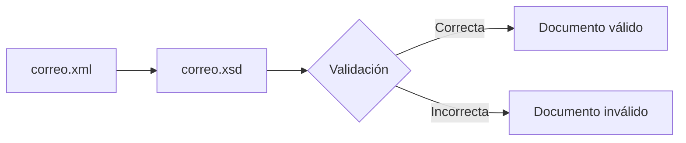

## 4. Asociar un XML a un esquema

En el apartado anterior aprendiste a crear un esquema XSD y a comprender su estructura.

Sin embargo, un esquema por sí solo no realiza ninguna validación. Para que un programa pueda comprobar si un documento XML cumple las reglas definidas en un XSD, ambos documentos deben estar asociados.

En este apartado aprenderás cómo enlazar un documento XML con su esquema correspondiente.

## 4.1 ¿Por qué asociar XML y XSD?

Supongamos que disponemos del siguiente esquema:

```xml
<xs:element name="correo">
    <xs:complexType>
        <xs:sequence>
            <xs:element name="de" type="xs:string"/>
            <xs:element name="para" type="xs:string"/>
            <xs:element name="mensaje" type="xs:string"/>
        </xs:sequence>
    </xs:complexType>
</xs:element>
```

Este esquema describe perfectamente la estructura que debe tener un documento XML.

Sin embargo, si abrimos un archivo XML cualquiera, el validador no sabe automáticamente qué esquema debe utilizar.

Por este motivo es necesario indicar explícitamente la ubicación del XSD.

!!! note "Idea clave"

    Un esquema XSD no valida documentos por sí mismo. El documento XML debe indicar qué esquema utilizar para realizar la validación.

## 4.2 XML Schema Instance (xsi)

Para asociar un documento XML con un esquema XSD es necesario declarar un espacio de nombres especial.

```xml
xmlns:xsi="http://www.w3.org/2001/XMLSchema-instance"
```

Este espacio de nombres recibe el nombre de XML Schema Instance.

Su función consiste en proporcionar atributos especiales relacionados con la validación XML.

## 4.3 Nuestro primer XML validado

Fichero:

```text
correo.xml
```

```xml
<?xml version="1.0" encoding="UTF-8"?>

<correo
    xmlns:xsi="http://www.w3.org/2001/XMLSchema-instance"
    xsi:noNamespaceSchemaLocation="correo.xsd">

    <de>origen@email.com</de>
    <para>destino@email.com</para>
    <mensaje>Este es un correo de prueba.</mensaje>

</correo>
```

## 4.4 Analizando correo.xml

### Declaración XML

```xml
<?xml version="1.0" encoding="UTF-8"?>
```

### Namespace XML Schema Instance

```xml
xmlns:xsi="http://www.w3.org/2001/XMLSchema-instance"
```

### Ubicación del esquema

```xml
xsi:noNamespaceSchemaLocation="correo.xsd"
```

## 4.5 El atributo noNamespaceSchemaLocation

Es la forma más sencilla de asociar un documento XML con un esquema XSD.

```xml
xsi:noNamespaceSchemaLocation="correo.xsd"
```

## 4.6 El proceso de validación



## 4.7 Errores frecuentes

- No indicar el esquema.
- Ruta incorrecta.
- Namespace xsi ausente.

## Ejercicios propuestos

### Ejercicio 1

¿Qué namespace se declara mediante xmlns:xsi?

??? tip "Solución"

    XML Schema Instance.

### Ejercicio 2

¿Qué atributo indica la ubicación del esquema?

??? tip "Solución"

    xsi:noNamespaceSchemaLocation.

## Actividad de reflexión

!!! question "Piensa"

    ¿Qué ventajas aporta que el documento XML indique explícitamente el esquema que debe utilizar?
