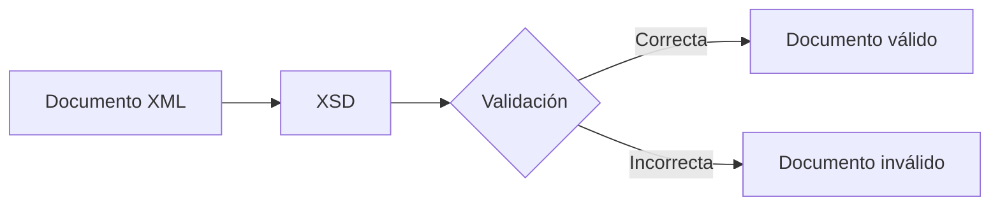

## 1. Introducción a XML Schema

En la unidad anterior aprendiste a validar documentos XML mediante DTD, definiendo elementos, atributos y restricciones que permitían comprobar automáticamente si un documento cumplía una estructura determinada.

Sin embargo, a medida que las aplicaciones intercambian información más compleja, se hace necesario utilizar sistemas de validación más avanzados. No basta con comprobar que los elementos aparecen en el orden correcto; también es importante verificar que los datos tienen el formato adecuado.

XML Schema, conocido habitualmente como XSD (*XML Schema Definition*), permite definir reglas mucho más precisas para validar documentos XML.

## 1.1 ¿Por qué DTD no siempre es suficiente?

Observa el siguiente documento XML:

```xml
<producto>
    <nombre>Portátil</nombre>
    <precio>899.95</precio>
</producto>
```

Una DTD puede indicar que el elemento `producto` contiene un `nombre` y un `precio`.

Sin embargo, no puede controlar fácilmente si el contenido de `precio` es realmente un número decimal.

Por ejemplo:

```xml
<producto>
    <nombre>Portátil</nombre>
    <precio>mucho dinero</precio>
</producto>
```

Desde el punto de vista estructural, este documento podría cumplir las reglas definidas en una DTD.

Sin embargo, para una aplicación de gestión comercial el valor del precio sería incorrecto.

!!! note "Idea clave"
    DTD permite validar la estructura de un documento XML, pero ofrece pocas posibilidades para controlar el tipo de datos que contiene.

## 1.2 ¿Qué es XML Schema?

XML Schema (XSD) es un lenguaje basado en XML que permite definir las reglas que debe cumplir un documento XML.

Gracias a XSD es posible especificar:

- Qué elementos pueden aparecer.
- En qué orden deben hacerlo.
- Cuántas veces pueden repetirse.
- Qué atributos puede tener cada elemento.
- Qué tipo de datos contiene cada valor.

Por ejemplo:

```xml
<xs:element name="precio" type="xs:decimal"/>
```

Esta definición indica que el elemento `precio` debe contener un número decimal.

Si el contenido fuera texto, el documento no sería válido.

## 1.3 Ventajas de XSD frente a DTD

XML Schema incorpora numerosas mejoras respecto a DTD.

| Característica | DTD | XSD |
| --- | --- | --- |
| Sintaxis XML | No | Sí |
| Tipos de datos | Limitados | Amplios |
| Validación de fechas | No | Sí |
| Validación de números | No | Sí |
| Namespaces | No | Sí |
| Restricciones avanzadas | Limitadas | Sí |

Por este motivo, XSD se ha convertido en el estándar más utilizado para la validación de documentos XML.

!!! warning "Importante"
    Un documento válido según XSD también debe estar correctamente formado según las reglas generales de XML.

## 1.4 El proceso de validación con XSD

Cuando un documento XML se asocia a un esquema XSD, un analizador puede comprobar automáticamente si cumple todas las reglas definidas.

El proceso suele desarrollarse de la siguiente forma:



La validación permite detectar errores antes de que los datos sean procesados por una aplicación.

## 1.5 XML, XSD y espacios de nombres

En documentos sencillos las etiquetas suelen ser suficientes para identificar la información.

Sin embargo, cuando diferentes organizaciones intercambian datos pueden aparecer elementos con el mismo nombre pero con significados distintos.

Por ejemplo:

```xml
<cli:nombre>Juan</cli:nombre>
```

```xml
<prov:nombre>Proveedor S.L.</prov:nombre>
```

Aunque ambas etiquetas se llaman `nombre`, pertenecen a espacios de nombres diferentes.

XML Schema utiliza estos espacios de nombres para validar correctamente documentos complejos.

!!! info "En esta unidad"
    Aprenderás a utilizar XML Schema, trabajar con espacios de nombres, definir restricciones avanzadas y garantizar la integridad de los datos de un documento XML.

## 1.6 ¿Por qué aprender XSD hoy?

A pesar de la aparición de nuevas tecnologías, XML continúa utilizándose ampliamente en numerosos ámbitos:

- Administración pública.
- Facturación electrónica.
- Intercambio de datos empresariales.
- Servicios web.
- Integración entre aplicaciones.

Muchos de estos sistemas utilizan esquemas XSD para garantizar la calidad y consistencia de la información intercambiada.

Además, comprender XML Schema facilita el aprendizaje de tecnologías posteriores como XPath y XSLT.

## Actividad de reflexión

!!! question "Piensa"

    ¿Qué problemas podrían aparecer en una aplicación si los documentos XML no verificaran automáticamente que los precios, fechas o identificadores tienen el formato correcto?

??? tip "Posible respuesta"

    La aplicación podría almacenar datos incorrectos, producir errores durante el procesamiento o intercambiar información inconsistente con otros sistemas.

!!! tip "Al terminar este apartado"

    Deberías comprender las limitaciones de DTD, conocer las principales ventajas de XML Schema y entender cómo participa un esquema XSD en el proceso de validación de documentos XML.
