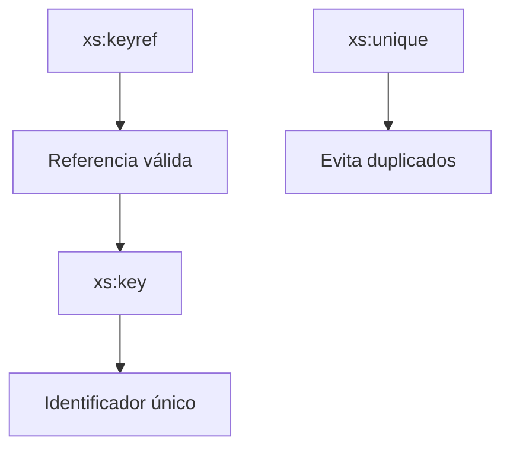

## 12. Integridad referencial en XML Schema

Hasta ahora hemos aprendido a definir estructuras, restricciones y tipos reutilizables.

Sin embargo, todavía existe un problema importante:

> ¿Cómo podemos garantizar que las relaciones entre distintos elementos sean correctas?

Por ejemplo:

```xml
<matricula alumno="A01"/>
```

¿Cómo podemos asegurarnos de que realmente existe un alumno con identificador `A01`?

XML Schema incorpora mecanismos para resolver este problema mediante:

```xml
xs:unique
xs:key
xs:keyref
```

Estos mecanismos permiten aplicar reglas similares a las claves primarias y foráneas de las bases de datos relacionales.

## 12.1 El problema de la consistencia

Observa el siguiente XML:

```xml
<instituto>

    <alumnos>

        <alumno id="A01">

            <nombre>Ana</nombre>

        </alumno>

    </alumnos>

    <matriculas>

        <matricula alumno="A01"/>

        <matricula alumno="A99"/>

    </matriculas>

</instituto>
```

¿Existe realmente el alumno:

```text
A99
```

?

No.

Sin mecanismos adicionales, XML Schema podría aceptar este documento.

Para evitar estos problemas utilizaremos reglas de integridad referencial.

!!! note "Idea clave"

    XML Schema permite garantizar la coherencia entre distintos elementos del documento.

## 12.2 ¿Qué es xs:unique?

La restricción:

```xml
<xs:unique>
```

garantiza que determinados valores no se repitan.

Ejemplo:

```xml
<alumno>

    <dni>12345678A</dni>

</alumno>
```

Podemos indicar que el DNI sea único.

```xml
<xs:unique name="dniUnico">
```

### XML válido

```xml
12345678A
87654321B
```

### XML inválido

```xml
12345678A
12345678A
```

Porque el valor aparece duplicado.

!!! note "Importante"

    xs:unique permite valores vacíos, siempre que los existentes no se repitan.

## 12.3 ¿Qué es xs:key?

La restricción:

```xml
<xs:key>
```

también garantiza unicidad.

Sin embargo, añade una diferencia importante:

> El valor debe existir obligatoriamente.

Por tanto:

```text
key = único + obligatorio
```

### XML válido

```xml
<alumno id="A01"/>

<alumno id="A02"/>
```

### XML inválido

```xml
<alumno/>
```

Porque falta el identificador.

### XML inválido

```xml
<alumno id="A01"/>

<alumno id="A01"/>
```

Porque existe una duplicidad.

## 12.4 Diferencias entre unique y key

| Característica | xs:unique | xs:key |
| --- | --- | --- |
| Evita duplicados | Sí | Sí |
| Valor obligatorio | No | Sí |
| Puede utilizarse como referencia | No | Sí |
| Similar a clave primaria | No exactamente | Sí |

### Regla práctica

```text
unique → único

key → único + obligatorio
```

## 12.5 ¿Qué es xs:keyref?

Una vez definido un `key`, podemos crear referencias hacia él mediante:

```xml
<xs:keyref>
```

Esta restricción funciona de manera similar a una clave foránea en bases de datos.

### XML válido

```xml
<alumno id="A01"/>

<matricula alumno="A01"/>
```

### XML inválido

```xml
<alumno id="A01"/>

<matricula alumno="A99"/>
```

Porque A99 no existe.

## 12.6 Relacionando elementos

La idea fundamental es que:

```text
xs:key
```

define los identificadores válidos.

Y:

```text
xs:keyref
```

permite referenciar únicamente esos identificadores.

Así se garantiza la integridad de los datos.

## 12.7 Caso práctico: Congreso, ponentes y charlas

Hasta ahora hemos utilizado ejemplos sencillos para comprender el funcionamiento de `xs:key` y `xs:keyref`.

Vamos ahora a estudiar un caso más cercano a una aplicación real.

Imaginemos que estamos desarrollando un sistema de gestión de congresos.

Cada charla debe estar asociada a un ponente registrado.

El objetivo es garantizar que:

✅ Cada ponente tenga un identificador único.

✅ Cada charla haga referencia a un ponente existente.

❌ No puedan existir referencias a ponentes inexistentes.

### Estructura conceptual

```text
Congreso
│
├── Ponentes
│     ├── P01
│     └── P02
│
└── Charlas
      ├── referencia a P01
      ├── referencia a P02
      └── referencia a P01
```

### Definición de la clave primaria

```xml
<xs:key name="ponenteKey">

    <xs:selector xpath=".//cong:ponente"/>

    <xs:field xpath="@id"/>

</xs:key>
```

#### Explicación

El selector:

```xml
.//cong:ponente
```

localiza todos los elementos:

```xml
<cong:ponente>
```

Posteriormente:

```xml
<xs:field xpath="@id"/>
```

indica que la clave está formada por el atributo:

```xml
id
```

Por tanto:

```text
P01
P02
P03
...
```

deben ser únicos.

### Definición de la referencia

```xml
<xs:keyref
    name="charlaPonenteRef"
    refer="cong:ponenteKey">

    <xs:selector xpath=".//cong:charla"/>

    <xs:field xpath="@ponente_ref"/>

</xs:keyref>
```

#### Explicación

XML Schema recorrerá todas las:

```xml
<cong:charla>
```

y comprobará que:

```xml
ponente_ref
```

contiene un identificador existente dentro de:

```xml
ponenteKey
```

### XML válido

```xml
<cong:ponente id="P01">

    <cong:nombre>Ana García</cong:nombre>

</cong:ponente>

<cong:ponente id="P02">

    <cong:nombre>Luis Ramos</cong:nombre>

</cong:ponente>

<cong:charla ponente_ref="P01">

    <cong:titulo>
        Introducción a XML Schema
    </cong:titulo>

</cong:charla>

<cong:charla ponente_ref="P02">

    <cong:titulo>
        Esquemas Modulares y Reutilización
    </cong:titulo>

</cong:charla>

<cong:charla ponente_ref="P01">

    <cong:titulo>
        Validación Avanzada con XSD
    </cong:titulo>

</cong:charla>
```

#### ¿Por qué es válido?

Porque:

```text
P01 existe
P02 existe
```

y todas las referencias pueden resolverse correctamente.

### XML inválido

```xml
<cong:charla ponente_ref="P03">

    <cong:titulo>
        Introducción a DTD
    </cong:titulo>

</cong:charla>
```

#### Error detectado

```text
No existe ningún ponente con id="P03".
```

Por tanto:

```xml
ponente_ref="P03"
```

no puede validarse frente a:

```xml
ponenteKey
```

y el documento será rechazado.

### Relación con bases de datos

Este ejemplo equivale a:

```sql
PONENTE(
    id PRIMARY KEY
)

CHARLA(
    ponente_ref REFERENCES PONENTE(id)
)
```

Correspondencia:

| Bases de datos | XML Schema |
|---|---|
| PRIMARY KEY | xs:key |
| FOREIGN KEY | xs:keyref |
| Campo clave | xs:field |
| Tabla | Elemento XML |

### ¿Qué hemos conseguido?

Gracias a `xs:key` y `xs:keyref`:

✅ Los identificadores de ponente no pueden repetirse.

✅ Todas las referencias son correctas.

✅ Se garantiza la integridad referencial.

✅ El comportamiento es equivalente al de una base de datos relacional.

## 12.8 Comparación con bases de datos

| Bases de datos | XML Schema |
| --- | --- |
| PRIMARY KEY | xs:key |
| UNIQUE | xs:unique |
| FOREIGN KEY | xs:keyref |

## 12.9 Resumen visual



## Ejercicios propuestos

### Ejercicio 1 · Detectando duplicados

Tenemos:

```text
A01
A02
A01
A03
```

¿Serían válidos con `xs:unique`?

??? tip "Solución"

    No.

    El valor A01 aparece repetido.

---

### Ejercicio 2 · Clave obligatoria

Diseña una clave para identificar alumnos mediante:

```xml
id
```

El identificador debe:

- Existir siempre.
- No repetirse.

??? tip "Solución"

    ```xml
    <xs:key>
    ```

    porque garantiza unicidad y obligatoriedad.

---

### Ejercicio 3 · XML válido o inválido

Analiza:

```xml
<alumno id="A01"/>

<alumno id="A02"/>
```

¿Es válido respecto a un `xs:key`?

??? tip "Solución"

    Sí.

    Ambos identificadores existen y son distintos.

---

### Ejercicio 4 · XML inválido

Analiza:

```xml
<alumno id="A01"/>

<alumno id="A01"/>
```

??? tip "Solución"

    No.

    La clave aparece duplicada.

---

### Ejercicio 5 · Relación alumno-matrícula

Queremos que:

```xml
<matricula alumno="A01"/>
```

apunte a un alumno existente.

Además:

```xml
<matricula alumno="A99"/>
```

debe producir un error.

¿Qué mecanismo debemos utilizar?

??? tip "Solución"

    ```xml
    <xs:keyref>
    ```

    porque crea una referencia hacia una clave definida mediante `xs:key`.

---

### Ejercicio 6 · Detectando referencias incorrectas

Analiza:

```xml
<alumno id="A01"/>

<matricula alumno="A99"/>
```

¿Es válido?

??? tip "Solución"

    No.

    El alumno A99 no existe y la referencia no puede resolverse.

---

### Ejercicio 7 · Diseñando un sistema de pedidos

Diseña una estructura donde:

```text
Cliente
Pedido
```

Cada pedido debe referenciar un cliente válido.

Indica:

- qué elemento sería la clave,
- qué elemento actuaría como referencia,
- qué mecanismos utilizarías.

??? tip "Solución"

    Cliente:

    ```xml
    <xs:key>
    ```

    Pedido:

    ```xml
    <xs:keyref>
    ```

    La relación es equivalente a una clave primaria y una clave foránea.

## Actividad de reflexión

!!! question "Piensa"

    ¿Por qué crees que XML Schema incluye mecanismos similares a las claves primarias y foráneas de las bases de datos?

??? tip "Posible respuesta"

    Porque muchos documentos XML contienen información relacionada y es necesario garantizar que todas las referencias sean correctas y consistentes.

!!! tip "Al terminar este apartado"

    Deberías ser capaz de utilizar `xs:unique`, `xs:key` y `xs:keyref`, comprender las diferencias entre ellos y modelar relaciones entre elementos XML de forma similar a las bases de datos relacionales.