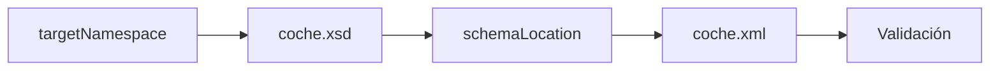

## 5. Namespaces y validación avanzada

En el apartado anterior aprendiste a asociar un documento XML con un esquema XSD utilizando `xsi:noNamespaceSchemaLocation`.

Este método resulta ideal para comenzar a trabajar con XML Schema. Sin embargo, en aplicaciones reales es habitual que diferentes organizaciones intercambien documentos XML utilizando espacios de nombres.

En estos casos necesitamos mecanismos más avanzados para asociar documentos XML y esquemas XSD.

## 5.1 ¿Por qué necesitamos namespaces?

Imagina que dos aplicaciones utilizan elementos llamados `nombre`.

```xml
<nombre>Juan</nombre>
```

```xml
<nombre>Empresa S.L.</nombre>
```

Aunque ambas utilizan la misma etiqueta, no representan la misma información.

Los espacios de nombres permiten diferenciar estos vocabularios y evitar conflictos.

!!! note "Idea clave"

    XML Schema está diseñado para trabajar con espacios de nombres y validar documentos XML complejos sin ambigüedades.

## 5.2 ¿Qué significa targetNamespace?

Cuando un esquema define su propio vocabulario XML utiliza el atributo:

```xml
targetNamespace="http://www.empresa.com/vehiculos"
```

Este atributo identifica de forma única todos los elementos definidos dentro del esquema.

A partir de ese momento, elementos como `coches`, `coche`, `marca` y `modelo` pertenecen a ese espacio de nombres.

## 5.3 Nuestro primer esquema completo con namespace

Fichero:

```text
coche.xsd
```

```xml
<?xml version="1.0" encoding="UTF-8"?>

<xs:schema
    xmlns:xs="http://www.w3.org/2001/XMLSchema"
    targetNamespace="http://www.empresa.com/vehiculos"
    xmlns:veh="http://www.empresa.com/vehiculos"
    elementFormDefault="qualified">

    <xs:element name="coches">

        <xs:complexType>

            <xs:sequence>

                <xs:element name="coche" maxOccurs="unbounded">

                    <xs:complexType>

                        <xs:sequence>

                            <xs:element name="marca" type="xs:string"/>
                            <xs:element name="modelo" type="xs:string"/>

                        </xs:sequence>

                    </xs:complexType>

                </xs:element>

            </xs:sequence>

        </xs:complexType>

    </xs:element>

</xs:schema>
```

### Analizando el esquema

- `targetNamespace` define el namespace principal.
- `xmlns:veh` asigna un prefijo al namespace.
- `elementFormDefault="qualified"` obliga a utilizar explícitamente el namespace.

## 5.4 El atributo schemaLocation

```xml
xsi:schemaLocation="
http://www.empresa.com/vehiculos
coche.xsd"
```

Funciona en parejas:

1. URI del namespace.
2. Ubicación del esquema XSD.

## 5.5 Documento XML asociado al esquema

Fichero:

```text
coche.xml
```

```xml
<?xml version="1.0" encoding="UTF-8"?>

<c:coches
    xmlns:c="http://www.empresa.com/vehiculos"
    xmlns:xsi="http://www.w3.org/2001/XMLSchema-instance"
    xsi:schemaLocation="
        http://www.empresa.com/vehiculos
        coche.xsd">

    <c:coche>
        <c:marca>Seat</c:marca>
        <c:modelo>Ibiza</c:modelo>
    </c:coche>

    <c:coche>
        <c:marca>Renault</c:marca>
        <c:modelo>Clio</c:modelo>
    </c:coche>

</c:coches>
```

## 5.6 Comparando ambos métodos

| Característica | noNamespaceSchemaLocation | schemaLocation |
| --- | --- | --- |
| Requiere namespace | No | Sí |
| Complejidad | Baja | Media |
| Uso profesional | Moderado | Muy habitual |

## 5.7 Resumen visual



## Ejercicios propuestos

### Ejercicio 1

¿Cuál es el prefijo y cuál es la URI?

```xml
xmlns:c="http://www.empresa.com/vehiculos"
```

??? tip "Solución"

    Prefijo: c
    URI: http://www.empresa.com/vehiculos

### Ejercicio 2

¿Para qué sirve targetNamespace?

??? tip "Solución"

    Define el espacio de nombres principal del esquema.

## Actividad de reflexión

!!! question "Piensa"

    ¿Por qué los sistemas empresariales suelen utilizar namespaces?
