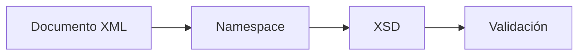

## 2. Espacios de nombres

A medida que los documentos XML aumentan de tamaño y complejidad, resulta habitual combinar información procedente de distintos sistemas, organizaciones o aplicaciones.

En estos casos puede aparecer un problema conocido como **colisión de nombres**, que ocurre cuando dos elementos tienen el mismo nombre pero representan conceptos diferentes.

Para resolver este problema XML incorpora los **espacios de nombres** (*namespaces*).

## 2.1 El problema: colisión de nombres

Observa el siguiente documento XML:

```xml
<datos>

    <cliente>
        <nombre>Juan</nombre>
        <apellidos>Pérez García</apellidos>
    </cliente>

    <proveedor>
        <nombre>Empresa S.L.</nombre>
        <apellidos>Comercial</apellidos>
    </proveedor>

</datos>
```

A simple vista el documento parece correcto.

Sin embargo, aparecen dos elementos llamados `nombre` y dos elementos llamados `apellidos`.

Si una aplicación recibe este XML, podría resultar difícil determinar a qué tipo de información pertenece cada uno de esos elementos.

!!! note "Idea clave"
    Cuando distintos conjuntos de datos utilizan etiquetas con el mismo nombre puede producirse una colisión de nombres.

## 2.2 ¿Qué es un espacio de nombres?

Un espacio de nombres es un mecanismo que permite diferenciar elementos y atributos que tienen el mismo nombre pero significados distintos.

Para ello se utiliza una **URI** (*Uniform Resource Identifier*) asociada a un prefijo.

La declaración de un espacio de nombres tiene la siguiente forma:

```xml
xmlns:prefijo="URI"
```

Por ejemplo:

```xml
xmlns:cli="http://www.empresa.com/clientes"
```

En este caso:

- `xmlns` indica que se está declarando un namespace.
- `cli` es el prefijo.
- La URI identifica de forma única el espacio de nombres.

## 2.3 La URI no es una página web

Un error muy frecuente consiste en pensar que la URI debe apuntar a una página web real.

```xml
xmlns:cli="http://www.empresa.com/clientes"
```

No significa que exista necesariamente una página web en esa dirección.

La URI actúa simplemente como identificador único.

Podemos compararla con el DNI de una persona o la matrícula de un vehículo: su función principal es identificar de forma única algo dentro de un determinado contexto.

!!! warning "Importante"
    La URI de un namespace no tiene por qué existir como página web. Su función principal es identificar de forma única un conjunto de elementos.

## 2.4 Utilizando prefijos

Una vez declarado el namespace, los elementos pueden utilizar el prefijo asociado.

```xml
<cli:cliente>
    <cli:nombre>Juan</cli:nombre>
    <cli:apellidos>Pérez García</cli:apellidos>
</cli:cliente>
```

Ahora todos los elementos pertenecen al espacio de nombres identificado por `cli`.

Esto elimina cualquier ambigüedad.

## 2.5 Resolviendo la colisión de nombres

```xml
<?xml version="1.0" encoding="UTF-8"?>

<datos
    xmlns:cli="http://www.empresa.com/clientes"
    xmlns:prov="http://www.empresa.com/proveedores">

    <cli:cliente>
        <cli:nombre>Juan</cli:nombre>
        <cli:apellidos>Pérez García</cli:apellidos>
    </cli:cliente>

    <prov:proveedor>
        <prov:nombre>Empresa S.L.</prov:nombre>
        <prov:apellidos>Comercial</prov:apellidos>
    </prov:proveedor>

</datos>
```

Ahora ya no existen dudas:

- `cli:nombre` pertenece al vocabulario de clientes.
- `prov:nombre` pertenece al vocabulario de proveedores.

El prefijo forma parte del nombre completo del elemento.

## 2.6 Relación entre namespaces y XSD

Los namespaces trabajan conjuntamente con XML Schema.

Por ejemplo:

```xml
<xs:schema
    xmlns:xs="http://www.w3.org/2001/XMLSchema">
```

En los documentos XSD es habitual utilizar el prefijo `xs` para identificar los elementos que pertenecen al lenguaje XML Schema.



!!! warning "Error frecuente"
    Los prefijos no son obligatorios.

    Lo importante es la URI asociada al espacio de nombres.

!!! info "En los próximos apartados"
    Utilizaremos espacios de nombres de forma habitual para asociar documentos XML con sus correspondientes esquemas XSD.

## Actividad de reflexión

!!! question "Piensa"
    ¿Qué problemas podrían aparecer si dos empresas intercambian documentos XML utilizando los mismos nombres de etiquetas para representar información diferente?

??? tip "Posible respuesta"
    Las aplicaciones podrían interpretar incorrectamente los datos recibidos.

!!! tip "Al terminar este apartado"
    Deberías comprender qué es un espacio de nombres, para qué sirve una URI, cómo utilizar prefijos y por qué los namespaces son fundamentales para trabajar con XML Schema.
