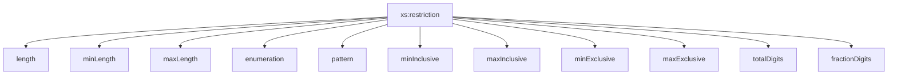

## 9. Restricciones de datos

Hasta ahora hemos aprendido a definir elementos, atributos y cardinalidades.

Sin embargo, todavía existe un problema importante: aunque un documento XML tenga la estructura correcta, algunos datos pueden contener valores incorrectos.

Por ejemplo:

```xml
<edad>doscientos</edad>
```

o:

```xml
<codigo_postal>ABC12</codigo_postal>
```

Desde el punto de vista estructural podrían ser válidos, pero los datos no tienen el formato esperado.

XML Schema permite resolver este problema mediante las **restricciones** (*facets*).

## 9.1 ¿Qué es una restricción?

Una restricción es una regla que limita los valores permitidos para un elemento o atributo.

Por ejemplo:

- Un código postal debe tener 5 dígitos.
- Una nota debe estar entre 0 y 10.
- Un PEGI solo puede ser 3, 7, 12, 16 o 18.
- Un precio debe tener como máximo 2 decimales.

Todas estas restricciones se definen mediante:

```xml
<xs:restriction>
```

!!! note "Idea clave"

    XML Schema no solo valida la estructura de un documento, también puede validar el contenido de los datos.

## 9.2 La etiqueta xs:restriction

La sintaxis general es:

```xml
<xs:simpleType>

    <xs:restriction base="xs:string">

        ...

    </xs:restriction>

</xs:simpleType>
```

Donde:

- `xs:restriction` indica que vamos a limitar un tipo de dato.
- `base` indica el tipo sobre el que se aplican las restricciones.

Por ejemplo:

```xml
<xs:restriction base="xs:string">
```

significa:

> "Partimos de una cadena de texto y aplicamos reglas adicionales."

## 9.3 Restricciones sobre cadenas

### Longitud exacta: length

Permite obligar a que una cadena tenga exactamente una determinada longitud.

Ejemplo:

```xml
<xs:element name="pin">

    <xs:simpleType>

        <xs:restriction base="xs:string">

            <xs:length value="4"/>

        </xs:restriction>

    </xs:simpleType>

</xs:element>
```

### XML válido

```xml
<pin>1234</pin>
```

### XML inválido

```xml
<pin>12345</pin>
```

Porque contiene cinco caracteres.

---

### Longitud mínima: minLength

Permite indicar el número mínimo de caracteres.

```xml
<xs:minLength value="8"/>
```

Ejemplo típico: contraseñas.

### XML válido

```xml
<password>segura123</password>
```

### XML inválido

```xml
<password>abc</password>
```

---

### Longitud máxima: maxLength

Permite limitar el tamaño máximo.

```xml
<xs:maxLength value="20"/>
```

Ejemplo:

```xml
<usuario>administrador</usuario>
```

sería válido si no supera la longitud establecida.

## 9.4 Valores permitidos: enumeration

En ocasiones queremos limitar un campo a un conjunto cerrado de valores.

Por ejemplo, la clasificación PEGI de un videojuego.

```xml
<xs:element name="pegi">

    <xs:simpleType>

        <xs:restriction base="xs:integer">

            <xs:enumeration value="3"/>
            <xs:enumeration value="7"/>
            <xs:enumeration value="12"/>
            <xs:enumeration value="16"/>
            <xs:enumeration value="18"/>

        </xs:restriction>

    </xs:simpleType>

</xs:element>
```

### XML válido

```xml
<pegi>12</pegi>
```

### XML inválido

```xml
<pegi>9</pegi>
```

Porque el valor 9 no pertenece a la lista permitida.

!!! note "Aplicación real"

    Las enumeraciones son muy útiles para estados, categorías, provincias, tipos de usuario, niveles de permiso o códigos predefinidos.

## 9.5 Patrones mediante expresiones regulares

Una de las restricciones más potentes es:

```xml
<xs:pattern>
```

Permite definir formatos concretos mediante expresiones regulares.

### Código postal

```xml
<xs:pattern value="[0-9]{5}"/>
```

### XML válido

```xml
<codigo_postal>12006</codigo_postal>
```

### XML inválido

```xml
<codigo_postal>12A06</codigo_postal>
```

---

### Matrícula simplificada

```xml
<xs:pattern value="[0-9]{4}[A-Z]{3}"/>
```

### XML válido

```xml
<matricula>1234ABC</matricula>
```

### XML inválido

```xml
<matricula>123ABC</matricula>
```

---

### Contraseña alfanumérica

```xml
<xs:pattern value="[a-zA-Z0-9]+"/>
```

Permite únicamente letras y números.

## 9.6 Restricciones numéricas

En muchas aplicaciones no basta con indicar que un valor es un número.

También es necesario controlar el rango permitido.

Por ejemplo:

- Una nota debe estar entre 0 y 10.
- La edad de una persona no puede ser negativa.
- Un porcentaje de IVA debe estar entre 0 y 100.
- El precio de un producto debe ser mayor que cero.

XML Schema permite aplicar estas limitaciones mediante restricciones numéricas.

### minInclusive

La restricción:

```xml
<xs:minInclusive value="0"/>
```

indica que el valor debe ser **mayor o igual que cero**.

### XML válido

```xml
<edad>0</edad>
```

```xml
<edad>35</edad>
```

### XML inválido

```xml
<edad>-5</edad>
```

---

### maxInclusive

La restricción:

```xml
<xs:maxInclusive value="10"/>
```

indica que el valor debe ser **menor o igual que diez**.

### XML válido

```xml
<nota>10</nota>
```

### XML válido

```xml
<nota>7.5</nota>
```

### XML inválido

```xml
<nota>12</nota>
```

---

### Combinando minInclusive y maxInclusive

```xml
<xs:element name="nota">

    <xs:simpleType>

        <xs:restriction base="xs:decimal">

            <xs:minInclusive value="0"/>

            <xs:maxInclusive value="10"/>

        </xs:restriction>

    </xs:simpleType>

</xs:element>
```

### XML válido

```xml
<nota>8.5</nota>
```

### XML inválido

```xml
<nota>-2</nota>
```

---

### minExclusive

Se utiliza cuando el valor debe ser estrictamente mayor que un límite.

```xml
<xs:minExclusive value="0"/>
```

### XML válido

```xml
<precio>1</precio>
```

### XML inválido

```xml
<precio>0</precio>
```

---

### maxExclusive

Se utiliza cuando el valor debe ser estrictamente menor que un límite.

```xml
<xs:maxExclusive value="100"/>
```

### XML válido

```xml
<descuento>99</descuento>
```

### XML inválido

```xml
<descuento>100</descuento>
```

---

### Comparativa rápida

| Restricción | Significado |
| --- | --- |
| `minInclusive` | Mayor o igual |
| `maxInclusive` | Menor o igual |
| `minExclusive` | Mayor que |
| `maxExclusive` | Menor que |

!!! note "Consejo"

    Si una condición indica "incluido", normalmente se utilizará una restricción `Inclusive`.

    Si indica "estrictamente mayor" o "estrictamente menor", se utilizará una restricción `Exclusive`.

## 9.7 Control de precisión decimal

### totalDigits

Indica cuántos dígitos puede tener un número en total.

```xml
<xs:totalDigits value="6"/>
```

### XML válido

```xml
123456
```

### XML inválido

```xml
1234567
```

### fractionDigits

Indica el número máximo de decimales permitidos.

```xml
<xs:fractionDigits value="2"/>
```

### XML válido

```xml
<precio>29.95</precio>
```

### XML inválido

```xml
<precio>29.955</precio>
```

## 9.8 Ejemplo completo

```xml
<xs:element name="producto">

    <xs:simpleType>

        <xs:restriction base="xs:string">

            <xs:minLength value="5"/>

            <xs:maxLength value="20"/>

            <xs:pattern value="[a-zA-Z0-9]+"/>

        </xs:restriction>

    </xs:simpleType>

</xs:element>
```
!!! info "¿Qué hace este código?"

    Este esquema define un elemento llamado `producto` cuyo contenido debe ser una cadena de texto (`xs:string`) que cumpla una serie de restricciones:

    - Debe tener una longitud mínima de **5 caracteres**.
    - Debe tener una longitud máxima de **20 caracteres**.
    - Solo puede contener **letras mayúsculas, minúsculas y números**.
    - No se permiten espacios, símbolos ni caracteres especiales.

## 9.9 Resumen visual



## Ejercicios propuestos


!!! question "Ejercicio 1 · Validando códigos postales"

Una empresa almacena códigos postales españoles.

Queremos asegurarnos de que:

- Contienen exactamente 5 dígitos.
- No contienen letras ni símbolos.

Diseña la restricción adecuada utilizando `xs:pattern`.

Después indica si los siguientes valores serían válidos:

```text
12006
28080
12A06
1234
123456
```

??? tip "Solución"

    Restricción:

    ```xml
    <xs:pattern value="[0-9]{5}"/>
    ```

    Resultado:

    - 12006 ✅ válido
    - 28080 ✅ válido
    - 12A06 ❌ inválido
    - 1234 ❌ inválido
    - 123456 ❌ inválido

!!! question "Ejercicio 2 · Clasificación PEGI"

Una tienda de videojuegos solo admite las siguientes clasificaciones:

```text
3
7
12
16
18
```

Diseña la restricción adecuada utilizando enumeraciones.

Después indica si los siguientes valores serían válidos:

```text
3
9
12
15
18
```

??? tip "Solución"

    ```xml
    <xs:restriction base="xs:integer">

        <xs:enumeration value="3"/>
        <xs:enumeration value="7"/>
        <xs:enumeration value="12"/>
        <xs:enumeration value="16"/>
        <xs:enumeration value="18"/>

    </xs:restriction>
    ```

    Resultado:

    - 3 ✅ válido
    - 9 ❌ inválido
    - 12 ✅ válido
    - 15 ❌ inválido
    - 18 ✅ válido

!!! question "Ejercicio 3 · Nota de examen"

Diseña una restricción para una nota entre 0 y 10.

Comprueba:

```text
8.5
0
10
12
-1
```

??? tip "Solución"

    ```xml
    <xs:minInclusive value="0"/>
    <xs:maxInclusive value="10"/>
    ```

    Resultado:

    - 8.5 ✅
    - 0 ✅
    - 10 ✅
    - 12 ❌
    - -1 ❌

!!! question "Ejercicio 4 · IVA"

Diseña una restricción para un porcentaje de IVA entre 0 y 100.

Comprueba:

```text
21
10
0
100
150
```

??? tip "Solución"

    ```xml
    <xs:minInclusive value="0"/>
    <xs:maxInclusive value="100"/>
    ```

    Resultado:

    - 21 ✅
    - 10 ✅
    - 0 ✅
    - 100 ✅
    - 150 ❌

!!! question "Ejercicio 5 · Descuento comercial"

Una tienda quiere almacenar descuentos.

El descuento:

- Debe ser mayor que 0.
- Debe ser menor que 100.

Utiliza restricciones exclusivas.

Analiza los siguientes valores:

```text
0
15
50
99
100
```

??? tip "Solución"

    ```xml
    <xs:minExclusive value="0"/>
    <xs:maxExclusive value="100"/>
    ```

    Resultado:

    - 0 ❌
    - 15 ✅
    - 50 ✅
    - 99 ✅
    - 100 ❌

!!! question "Ejercicio 6 · Contraseña segura"

Crea una restricción que obligue a que:

- La contraseña tenga entre 8 y 20 caracteres.
- Solo pueda contener letras y números.

Determina si serían válidas:

```text
segura123
abc
mipassword2026
mi-clave
```

??? tip "Solución"

    ```xml
    <xs:minLength value="8"/>
    <xs:maxLength value="20"/>
    <xs:pattern value="[a-zA-Z0-9]+"/>
    ```

    Resultado:

    - segura123 ✅
    - abc ❌
    - mipassword2026 ✅
    - mi-clave ❌

!!! question "Ejercicio 7 · Diseñando una matrícula"

Queremos validar una matrícula simplificada:

```text
1234ABC
```

Debe contener:

- Cuatro números.
- Tres letras mayúsculas.

Diseña la restricción adecuada.

Comprueba:

```text
1234ABC
123ABC
1234abc
12345ABC
```

??? tip "Solución"

    ```xml
    <xs:pattern value="[0-9]{4}[A-Z]{3}"/>
    ```

    Resultado:

    - 1234ABC ✅
    - 123ABC ❌
    - 1234abc ❌
    - 12345ABC ❌

## Actividad de reflexión

!!! question "Piensa"

    ¿Por qué crees que XML Schema ofrece mecanismos tan avanzados para restringir los datos?

??? tip "Posible respuesta"

    Porque muchas aplicaciones necesitan garantizar que los datos tengan el formato correcto antes de ser procesados o enviados a otros sistemas.

!!! tip "Al terminar este apartado"

    Deberías ser capaz de utilizar restricciones para validar cadenas, números, listas de valores permitidos y formatos específicos mediante expresiones regulares.