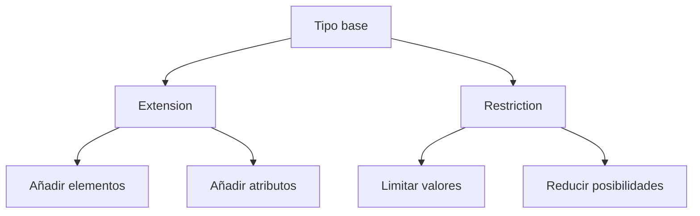

## 10. Reutilización y modularidad

A medida que nuestros esquemas XML crecen, es habitual que aparezcan estructuras o restricciones que se repiten una y otra vez.

Por ejemplo:

- Tipos de direcciones.
- Tipos de usuarios.
- Códigos postales.
- Correos electrónicos.
- Productos.
- Empleados.

Si copiamos y pegamos continuamente las mismas definiciones estaremos creando esquemas difíciles de mantener.

Para evitar este problema, XML Schema permite reutilizar componentes y construir esquemas modulares.

## 10.1 ¿Por qué reutilizar?

Observa el siguiente ejemplo:

```xml
<xs:element name="dispositivo_principal">

    <xs:simpleType>

        <xs:restriction base="xs:string">

            <xs:enumeration value="movil"/>

            <xs:enumeration value="tablet"/>

            <xs:enumeration value="ordenador"/>

        </xs:restriction>

    </xs:simpleType>

</xs:element>
```

Imagina que necesitamos la misma definición para:

- dispositivo_principal
- dispositivo_secundario
- dispositivo_empresa

La peor solución sería copiar el bloque completo varias veces.

La mejor solución consiste en definir un tipo reutilizable.

!!! note "Idea clave"

    Reutilizar evita duplicar código y facilita el mantenimiento de los esquemas.

## 10.2 El principio DRY

En desarrollo de software existe un principio muy importante denominado:

```text
DRY → Don't Repeat Yourself
```

Su objetivo es evitar que una misma definición aparezca repetida varias veces.

Si una regla cambia:

✅ Modificamos un único lugar.

❌ No tenemos que localizar todas las copias.

XML Schema incorpora mecanismos específicos para aplicar este principio.

## 10.3 Creando tipos simples reutilizables

Podemos asignar un nombre a cualquier tipo simple.

Ejemplo:

```xml
<xs:simpleType name="TipoDispositivo">

    <xs:restriction base="xs:string">

        <xs:enumeration value="movil"/>

        <xs:enumeration value="tablet"/>

        <xs:enumeration value="ordenador"/>

    </xs:restriction>

</xs:simpleType>
```

Ahora ya no necesitamos repetir la definición.

Podemos reutilizarla:

```xml
<xs:element
    name="dispositivo_principal"
    type="TipoDispositivo"/>
```

```xml
<xs:element
    name="dispositivo_secundario"
    type="TipoDispositivo"/>
```

### XML válido

```xml
<dispositivo_principal>movil</dispositivo_principal>
```

### XML inválido

```xml
<dispositivo_principal>consola</dispositivo_principal>
```

Porque no pertenece a los valores permitidos.

## 10.4 Creando tipos complejos reutilizables

La reutilización también funciona con tipos complejos.

Ejemplo:

```xml
<xs:complexType name="TipoPersona">

    <xs:sequence>

        <xs:element
            name="nombre"
            type="xs:string"/>

        <xs:element
            name="email"
            type="xs:string"/>

    </xs:sequence>

</xs:complexType>
```

Podemos reutilizar este tipo:

```xml
<xs:element
    name="cliente"
    type="TipoPersona"/>
```

```xml
<xs:element
    name="empleado"
    type="TipoPersona"/>
```

Así evitamos duplicar definiciones.

## 10.5 Derivación por extensión

En ocasiones necesitamos crear un nuevo tipo a partir de otro existente.

Para ello utilizamos:

```xml
<xs:extension>
```

La extensión permite añadir nuevos elementos o atributos.

Imaginemos que ya existe:

```xml
TipoPersona
```

y queremos crear:

```xml
TipoEmpleado
```

### Tipo base

```xml
<xs:complexType name="TipoPersona">

    <xs:sequence>

        <xs:element
            name="nombre"
            type="xs:string"/>

        <xs:element
            name="email"
            type="xs:string"/>

    </xs:sequence>

</xs:complexType>
```

### Tipo derivado

```xml
<xs:complexType name="TipoEmpleado">

    <xs:complexContent>

        <xs:extension base="TipoPersona">

            <xs:sequence>

                <xs:element
                    name="id_empleado"
                    type="xs:integer"/>

                <xs:element
                    name="departamento"
                    type="xs:string"/>

            </xs:sequence>

        </xs:extension>

    </xs:complexContent>

</xs:complexType>
```

### Resultado

Un empleado contendrá:

```text
nombre
email
id_empleado
departamento
```

!!! note "Herencia"

    La extensión funciona de forma similar a la herencia en programación orientada a objetos.

## 10.6 Derivación por restricción

También podemos crear un tipo más específico a partir de otro.

En este caso utilizamos:

```xml
<xs:restriction>
```

Ejemplo:

```xml
<xs:simpleType name="TipoCodigoPostal">

    <xs:restriction base="xs:string">

        <xs:length value="5"/>

        <xs:pattern value="[0-9]{5}"/>

    </xs:restriction>

</xs:simpleType>
```

Ahora tenemos un nuevo tipo reutilizable:

```xml
<xs:element
    name="codigo_envio"
    type="TipoCodigoPostal"/>
```

### XML válido

```xml
<codigo_envio>12006</codigo_envio>
```

### XML inválido

```xml
<codigo_envio>12A06</codigo_envio>
```

## 10.7 ¿Cuándo utilizar extensión y cuándo restricción?

| Situación | Solución |
| --- | --- |
| Añadir elementos nuevos | xs:extension |
| Añadir atributos nuevos | xs:extension |
| Limitar valores permitidos | xs:restriction |
| Reducir posibilidades de un tipo existente | xs:restriction |

### Regla práctica

```text
Extension → añadir
Restriction → limitar
```

## 10.8 Ejemplo completo

Supongamos una tienda informática.

Primero definimos el tipo:

```xml
<xs:simpleType name="TipoDispositivo">

    <xs:restriction base="xs:string">

        <xs:enumeration value="movil"/>

        <xs:enumeration value="tablet"/>

        <xs:enumeration value="ordenador"/>

    </xs:restriction>

</xs:simpleType>
```

Después lo reutilizamos:

```xml
<xs:element
    name="dispositivo_principal"
    type="TipoDispositivo"/>

<xs:element
    name="dispositivo_secundario"
    type="TipoDispositivo"/>
```

Con una única definición podemos validar múltiples elementos.

## 10.9 Resumen visual



## Ejercicios propuestos

### Ejercicio 1 · Tipo de colores

Crea un tipo reutilizable llamado:

```text
TipoColor
```

que permita únicamente:

```text
rojo
verde
azul
```

??? tip "Solución"

    ```xml
    <xs:simpleType name="TipoColor">

        <xs:restriction base="xs:string">

            <xs:enumeration value="rojo"/>

            <xs:enumeration value="verde"/>

            <xs:enumeration value="azul"/>

        </xs:restriction>

    </xs:simpleType>
    ```

### Ejercicio 2 · Tipo de dispositivos

Crea un tipo reutilizable para:

```text
movil
tablet
ordenador
```

y utilízalo posteriormente en dos elementos distintos.

??? tip "Solución"

    Crear un simpleType con nombre y reutilizarlo mediante el atributo `type`.

### Ejercicio 3 · TipoPersona

Diseña un tipo complejo llamado:

```text
TipoPersona
```

que contenga:

- nombre
- email

??? tip "Solución"

    Utilizar `xs:complexType` con una secuencia de dos elementos.

### Ejercicio 4 · TipoEmpleado

A partir de:

```text
TipoPersona
```

crea:

```text
TipoEmpleado
```

añadiendo:

- id_empleado
- departamento

??? tip "Solución"

    Utilizar:

    ```xml
    <xs:extension>
    ```

### Ejercicio 5 · Código postal

Diseña un tipo reutilizable:

```text
TipoCodigoPostal
```

que valide códigos postales españoles.

??? tip "Solución"

    Utilizar:

    - length = 5
    - pattern = [0-9]{5}

### Ejercicio 6 · XML válido o inválido

Suponiendo:

```xml
<xs:enumeration value="movil"/>

<xs:enumeration value="tablet"/>

<xs:enumeration value="ordenador"/>
```

¿Es válido?

```xml
<dispositivo>tablet</dispositivo>
```

¿Y?

```xml
<dispositivo>consola</dispositivo>
```

??? tip "Solución"

    - tablet ✅ válido
    - consola ❌ inválido

### Ejercicio 7 · Diseñando una jerarquía

Diseña una estructura donde:

```text
TipoVehiculo
```

contenga:

- marca
- modelo

y posteriormente:

```text
TipoCoche
```

amplíe dicho tipo añadiendo:

- matricula

??? tip "Solución"

    Crear TipoVehiculo como tipo base y TipoCoche mediante xs:extension.

## Actividad de reflexión

!!! question "Piensa"

    ¿Por qué crees que XML Schema incorpora mecanismos para reutilizar componentes y construir tipos derivados?

??? tip "Posible respuesta"

    Porque evita duplicar definiciones, facilita el mantenimiento de los esquemas y permite construir estructuras complejas de forma más organizada.

!!! tip "Al terminar este apartado"

    Deberías ser capaz de crear tipos reutilizables, aplicar el principio DRY y utilizar mecanismos de extensión y restricción para construir esquemas XML más flexibles y mantenibles.